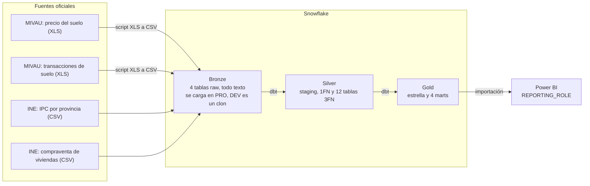
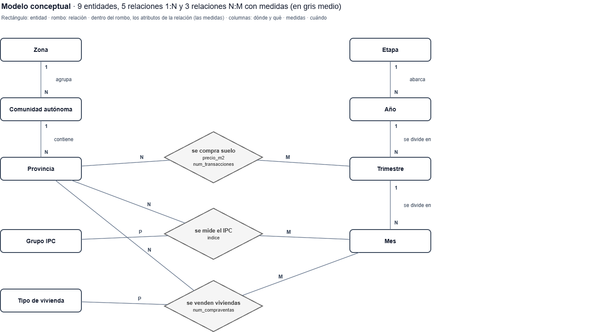
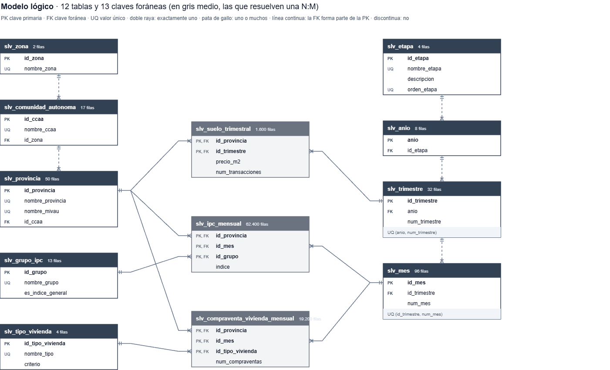
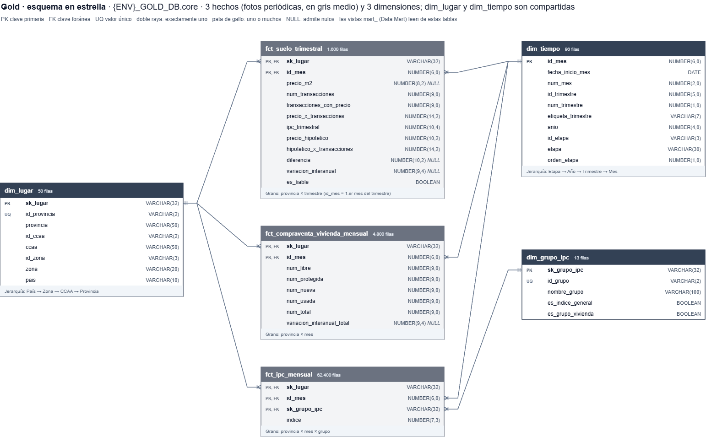
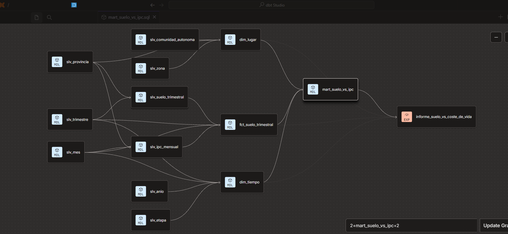
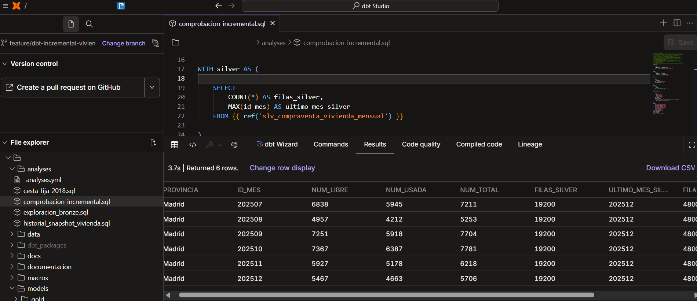
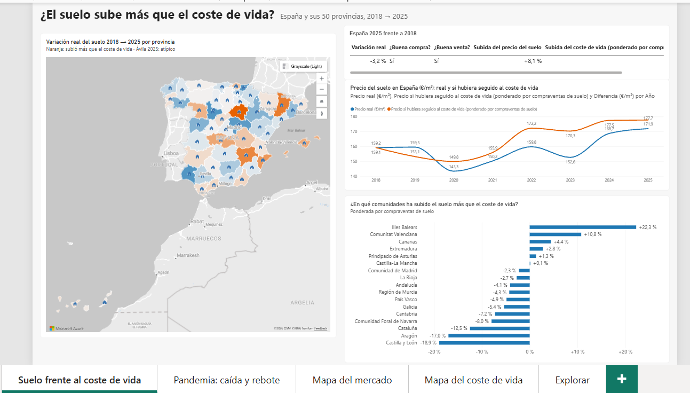
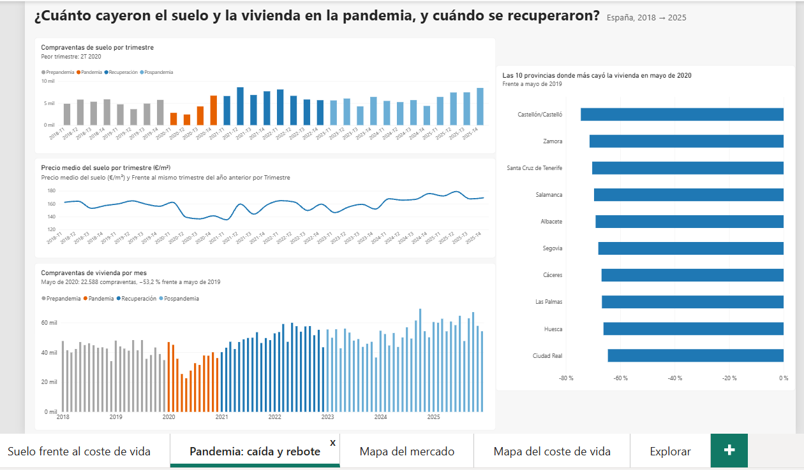
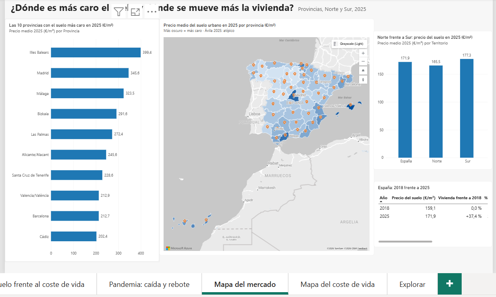
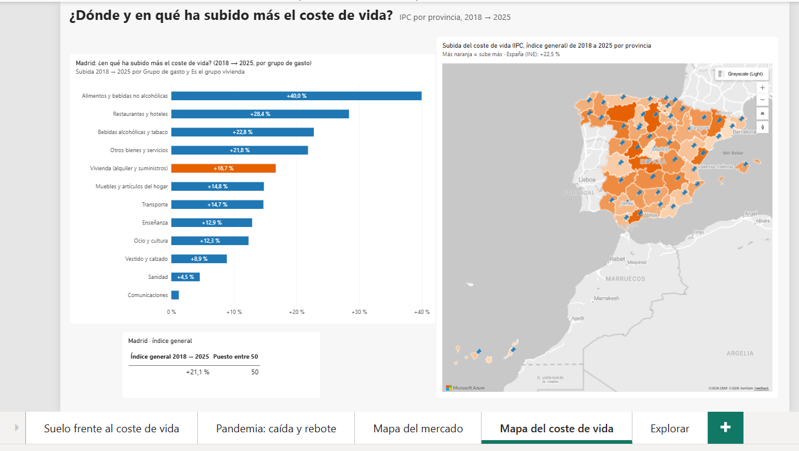

# Suelo urbano frente al coste de vida en España (2018-2025)

**Proyecto de Data Engineering de principio a fin** (empezó como proyecto final de un curso de Data Engineer). Del Excel del ministerio al Data Mart: cuatro fuentes oficiales (MIVAU e INE) cargadas en **Snowflake**, transformadas con **dbt** por capas (Bronze → Silver → Gold → marts) y visualizadas en **Power BI**, por provincias y de 2018 a 2025: antes, durante y después de la pandemia.

> **La pregunta:** ¿el precio del suelo urbano ha subido más o menos que el coste de vida? ¿Cómo lo afectó la pandemia, cómo cambia por provincias y zonas y cómo se mueve la compraventa de viviendas?
>
> Se cuenta desde quien quiere comprar: una persona de 30 años que quiere entender el mercado antes de comprarse un piso. También sirve a promotoras, inmobiliarias e inversores.

## Contenido

1. [Hallazgos](#1-hallazgos)
2. [Arquitectura](#2-arquitectura)
3. [Fuentes de datos](#3-fuentes-de-datos)
4. [Modelo de datos](#4-modelo-de-datos)
5. [Transformación con dbt](#5-transformación-con-dbt)
6. [Carga incremental](#6-carga-incremental)
7. [Tests y calidad](#7-tests-y-calidad)
8. [Casos de uso y Power BI](#8-casos-de-uso-y-power-bi)
9. [Cómo reproducir](#9-cómo-reproducir)
10. [Estructura del repositorio](#10-estructura-del-repositorio)
11. [Decisiones, limitaciones y siguientes pasos](#11-decisiones-limitaciones-y-siguientes-pasos)
12. [Capturas](#12-capturas)

---

## 1. Hallazgos

| Caso | Pregunta | Resultado (2018 → 2025) |
|---|---|---|
| 1 · Suelo frente al coste de vida | ¿El suelo sube más que el coste de vida? | En España, el m² de suelo pasa de 159,1 a **171,9 €** (+8,1 %). Si hubiera seguido al coste de vida de cada provincia, costaría **177,7 €** (+11,7 %). **Variación real: −3,2 %. Prácticamente a la par, algo por debajo.** Pero cada provincia es un mundo: **24 de 50** suben más que su coste de vida (Soria +45,5 %, Lleida +36,9 %, Albacete +33,5 %) y en el otro extremo están Ávila (−48,6 %), Valladolid y Huelva (−36,8 %) |
| 2 · Pandemia: caída y rebote | ¿Cómo afectó la pandemia al suelo y a la vivienda? | El suelo toca su mínimo en 2020: **143,3 €/m² (−10,2 %)**. El peor trimestre es el 2T 2020, con **2.425 compraventas de suelo (−33,3 %)**. La vivienda se hunde en **mayo de 2020: 22.588 compraventas, −53,2 %** frente a mayo de 2019. En 2021 llega el rebote: **+84 %** en compraventas de suelo y +34,8 % en vivienda |
| 3 · Mapa del mercado | ¿Dónde es más caro el suelo y dónde se mueve más la vivienda? | En 2025 el m² cuesta **399,4 €** en Illes Balears, **unas 7 veces** el de León (57,2 €) y más de 10 veces el de Ávila (37,9 €, dato atípico). El Sur es algo más caro que el Norte (**177,3 frente a 165,5 €/m²**). Se venden un **37,4 % más de viviendas** que en 2018 y la vivienda protegida baja del **9,6 % al 6,8 %** |
| 4 · Mapa del coste de vida | ¿Dónde y en qué ha subido más el coste de vida? | IPC (índice general, media anual): de **Madrid +21,1 %** (la que menos) a **Ávila y León +25,5 %** (las que más). España, +22,5 % (IPC Nacional del INE, como referencia). En España, los alimentos suben **+39,3 %** y la vivienda (alquiler y suministros), +19,5 % |

**Cómo leer el caso 1.** El +11,7 % de España no es el IPC: es lo que costaría el suelo vendido cada año si hubiera seguido al IPC de su provincia. Cada año se vende más suelo en provincias baratas (las 10 más caras pasan del 37,2 % al 30,1 % de las compraventas), y ese efecto composición baja la media nacional. La variación real es fiable porque el precio real y el hipotético usan los mismos pesos. Con una cesta fija de 2018 (`analyses/cesta_fija_2018.sql`) sale suelo +20,9 %, coste de vida +22,5 % y variación real −1,3 %: la conclusión no cambia. Por eso el titular de España es la variación real y la lectura principal es por provincia.

---

## 2. Arquitectura



| Capa | Dónde | Qué hay | Materialización |
|---|---|---|---|
| Bronze | `{ENV}_BRONZE_DB` (esquemas `MIVAU`, `INE` y `UTILS`) | 4 tablas raw (todo `VARCHAR` + `_loaded_at`, `_fichero`, `_fila`), stage, file formats, 2 UDFs, procedimiento de carga y tabla de auditoría | Tablas de Snowflake |
| Staging | `{ENV}_SILVER_DB.staging` | 4 `stg_`: renombrar, `TRIM` y convertir con las UDFs | Vistas |
| Silver 1FN | `{ENV}_SILVER_DB.silver` | 4 `int_`: columnas a filas, separar código y nombre, quitar agregados | Vistas |
| Silver 3FN | `{ENV}_SILVER_DB.silver` | 12 tablas `slv_` (83.426 filas) | Tablas; vivienda, incremental (`merge`) |
| Gold core | `{ENV}_GOLD_DB.core` | 3 dimensiones y 3 hechos | Tablas; vivienda, incremental (`delete+insert`) |
| Gold marts | `{ENV}_GOLD_DB.marts` | 4 `mart_`, uno por caso de uso | Vistas |

Además: seeds en `{ENV}_SILVER_DB.seeds`, el snapshot en `{ENV}_SILVER_DB.snapshots` y las filas que fallan en los tests en `dbt_jobs`.

- **Dos entornos, DEV y PRO**, con 6 bases (Bronze, Silver y Gold de cada uno), el warehouse `WH_CURSO` (XS, con autosuspensión), un rol de transformación por entorno (`DEV_TRANSFORM_ROLE` y `PRO_TRANSFORM_ROLE`) y `REPORTING_ROLE`, que solo lee Gold de PRO. Sin PRE: en un proyecto de una persona nadie valida antes de producción.
- **Los datos y el código van en sentidos distintos.** Los datos se cargan en PRO y Bronze de DEV es un clon (zero-copy) de PRO. El código va de DEV a PRO: rama → pull request → merge a `main` → job de DEV → job de PRO. Así, las entregas simuladas de las demos viven solo en DEV y se limpian volviendo a clonar.
- **Bronze guarda los ficheros tal como llegan.** El procedimiento `SP_CARGAR_BRONZE` hace `TRUNCATE` + `COPY INTO` (idempotente) y registra cada carga en `AUDITORIA_CARGAS`. `_fila` permite rastrear cada dato hasta su fila del fichero (en los del ministerio, la fila de Excel). dbt solo lee Bronze con `source()` y nunca escribe en él.
- **Dos cadenas coherentes:** suelo e IPC son series cerradas y van con carga completa en todas las capas; la compraventa de viviendas llega cada mes con correcciones y es incremental desde Silver (§6).
- **Seguridad:** el usuario tiene MFA y dbt y Power BI se conectan con par de claves; cada sesión trabaja solo con su rol (sin roles secundarios); el repositorio no contiene credenciales ni datos.

---

## 3. Fuentes de datos

| # | Fuente | Fichero | Uso |
|---|---|---|---|
| F1 | MIVAU, Estadística de Precios de Suelo Urbano, tabla 4: precio medio del m² por CCAA y provincia, trimestral | [36400500.XLS](https://apps.fomento.gob.es/BoletinOnline2/sedal/36400500.XLS) | Precio del suelo |
| F2 | MIVAU, misma estadística, tabla 1: número de transacciones de suelo | [36100500.XLS](https://apps.fomento.gob.es/BoletinOnline2/sedal/36100500.XLS) | Compraventas de suelo y pesos de las medias |
| F3 | INE, IPC, tabla 50918: índices provinciales, general y de grupos ECOICOP, base 2021, mensual | [50918.csv](https://www.ine.es/jaxiT3/files/t/csv_bdsc/50918.csv) | Coste de vida |
| F4 | INE, Estadística de Transmisiones de Derechos de la Propiedad, tabla 6150: compraventa de viviendas según régimen y estado, mensual, por provincia | [6150.csv](https://www.ine.es/jaxiT3/files/t/csv_bdsc/6150.csv) | Actividad del mercado de vivienda |

- Descargados el 18-nov-2026. Las huellas SHA-256, la conversión de los XLS a CSV (`scripts/convertir_xls_a_csv.py`, que cambia el formato pero no el contenido) y las comprobaciones de cada fichero están en [`data/README.md`](data/README.md). Los datos no se suben al repositorio.
- **Defectos reales que resuelve el pipeline:** 90 trimestres en columnas; total nacional, CCAA y provincias mezclados en una columna; `n.s.`, `n.s` y `.` como "sin dato"; espacios al final de los nombres; el 4T 2023 sin etiqueta en la tabla 1 (el periodo se asigna por posición); código y nombre en el mismo campo (`28 Madrid`); dos clasificaciones en una columna (libre/protegida y nueva/usada); el código `09` es Cataluña como CCAA y Burgos como provincia; y cada fuente escribe la provincia a su manera (`Vizcaya` / `Bizkaia`, `Avila` / `Ávila`).
- **Ámbito:** 50 provincias y periodo 2018-2025 (variables `anio_inicio` y `anio_fin`). Ceuta y Melilla se excluyen del análisis (0,03 % de las compraventas de suelo y 0,19 % de las de vivienda), pero siguen en Bronze y en los tests de conciliación.
- **Notas de método:** suelo y vivienda son compraventas registradas, no tasaciones; la compra de vivienda no está en el IPC (el grupo 04 recoge el alquiler y los suministros); el IPC base 2021 de la tabla 50918 llega hasta diciembre de 2025; los datos de vivienda son provisionales y el INE los corrige (el 25-sep-2026 actualizó julio-diciembre de 2025).
- Reutilización libre citando la fuente: Ministerio de Vivienda y Agenda Urbana (MIVAU) e Instituto Nacional de Estadística (INE).

---

## 4. Modelo de datos

El diseño completo (modelo conceptual, lógico y físico, normalización paso a paso, estrella, diccionario de datos, marts y catálogo de métricas) está en [`documentacion/diseno_modelo.md`](documentacion/diseno_modelo.md). Los diagramas se editan en draw.io (ficheros `.drawio` de `documentacion/`).

**Modelo conceptual:** 9 entidades, 5 relaciones jerárquicas 1:N y 3 relaciones N:M con medidas (dos de ellas ternarias). Las medidas son atributos de las relaciones: el precio no es "de Madrid" ni "del 2T 2020", es de Madrid en el 2T 2020.



**Silver en 3FN:** 12 tablas y 13 claves foráneas. La clave común es el código oficial del INE (provincia 01-50, CCAA 01-17), con un seed de correspondencia para cruzar los nombres del ministerio. Lo que se puede recalcular (totales nacionales y de CCAA, total de viviendas) no se guarda: se usa en los tests de conciliación.



**Gold en estrella:** 3 hechos, cada uno en su grano natural (fotos periódicas: suelo por provincia y trimestre, vivienda por provincia y mes, IPC por provincia, mes y grupo de gasto), y 3 dimensiones. `dim_lugar` y `dim_tiempo` las comparten los tres hechos (dimensiones conformadas); el suelo se une a `dim_tiempo` por el primer mes de su trimestre y nunca se reparte entre meses.



**Marts:** 4 vistas, una por caso de uso, con las cifras ya calculadas. Los casos 1 y 3 tienen una fila por territorio y año en 4 niveles (provincia, CCAA, zona y España), calculados con `GROUPING SETS`; el caso 2, provincia y España por mes; el caso 4, provincia, grupo de gasto y año.

**Reglas del modelo que más pesan:**
- **Un precio medio no se promedia.** Se guardan numerador y denominador (`precio_x_transacciones` y `transacciones_con_precio`) y se divide al final.
- **El precio real y el hipotético se agregan con los mismos pesos** (`hipotetico_x_transacciones`), para que la comparación sea homogénea.
- **El IPC no se agrega por encima de la provincia:** faltan las ponderaciones del INE. El caso 4 es solo por provincia y la cifra de España es el IPC Nacional, como referencia.
- **"Una métrica, un sitio":** las fórmulas viven en las macros de `macros/metricas.sql`; Power BI solo lee, suma y divide sumas.

---

## 5. Transformación con dbt

**Inventario (`main`):** 30 modelos (12 vistas, 16 tablas y 2 incrementales), 2 seeds, 1 snapshot, 257 tests, 4 analyses, 5 selectores, 4 bloques de documentación y 1 exposure. `dbt build` completo: **291 PASS** (30 modelos + 2 seeds + 1 snapshot + 257 tests + el hook de fin de ejecución); dbt muestra además `NO-OP=1`, que es la exposure.

| Técnica | Dónde se ve |
|---|---|
| **Jinja** | `{{ unpivot_trimestres('precio_hoja', 'precio_m2') }}` convierte las 90 columnas de trimestres en filas: el modelo tiene 78 líneas y su SQL compilado, 1.878 (180 `SELECT` y 178 `UNION ALL`). El año y el trimestre salen de la posición de la columna, así que el 4T 2023 sin etiqueta no rompe nada. Otro bucle (`for` y `loop.last`) pivota los 4 tipos de vivienda a columnas |
| **Macros** | `metricas.sql` (`media_ponderada`, `ratio`, `variacion_pct`, `variacion_real` y `precio_hipotetico`); `separar_codigo_nombre` (3 usos en 2 fuentes); `columnas_trimestres_mivau` y `unpivot_trimestres`; `ventana_revision` (incremental); `generate_schema_name`; `log_run_summary` (hook `on-run-end`); `grant_select_on_gold` (`run-operation` con `dry_run`) |
| **Paquete `dbt_utils`** | `date_spine` (calendario), `generate_surrogate_key` (claves `sk_` de Gold) y tests |
| **YAML** | Sources con freshness; seeds con `column_types` (para que `01` no se convierta en `1`); descripción de modelos, columnas y tests; bloques `` en `docs/conceptos.md`; snapshot; exposure; selectores |
| **Variables** | `anio_inicio` (2018), `anio_fin` (2025), `anio_base` (2018), `umbral_fiabilidad` (20) y `meses_revision` (12) |
| **Selectores** (`selectors.yml`) | `capa_silver`, `caso_1`, `informe_power_bi`, `entrega_vivienda` y `todo_sin_snapshots` |
| **Analyses** | `exploracion_bronze`, `historial_snapshot_vivienda`, `cesta_fija_2018` y `comprobacion_incremental`: consultas que dbt compila pero no construye |
| **Exposure** | `informe_suelo_vs_coste_de_vida`: el informe de Power BI aparece en el linaje, de las 4 fuentes al informe |
| **Snapshot** | `snp_compraventa_vivienda` (SCD2, estrategia `check` sobre `num_compraventas`): historial de las revisiones que el INE hace de sus datos provisionales |
| **Jobs** | "DEV - build completo" y "PRO - build completo", lanzados a mano tras cada merge. El de PRO ejecuta `deps`, `source freshness`, `build`, los permisos de `REPORTING_ROLE` y `docs generate`, y avisa por email si algo falla o avisa |

**Evolución por iteraciones:** MVP de suelo (201 PASS) → IPC en Gold (226) → vivienda (284) → remates (290) → umbrales de tests (291) → incremental (291, sin tests nuevos). Cada fase entró en `main` con su propio pull request; este repositorio publica la versión final, sin aquel historial.



Linaje completo, de las 4 fuentes al informe: [`06b_linaje_dbt.png`](documentacion/img/06b_linaje_dbt.png).

---

## 6. Carga incremental

La compraventa de viviendas del INE (tabla 6150) llega cada mes como un fichero completo, con meses nuevos y con los últimos meses corregidos: el INE publica los datos como provisionales y los revisa al publicar el mismo periodo del año siguiente.

- Bronze guarda la entrega tal como llega (`TRUNCATE` + `COPY` con `SP_CARGAR_BRONZE`).
- `slv_compraventa_vivienda_mensual` es incremental con `merge` (clave provincia, mes y tipo) y `fct_compraventa_vivienda_mensual`, incremental con `delete+insert` (clave `sk_lugar` e `id_mes`, su grano). Los marts son vistas.
- Cada ejecución reprocesa solo la ventana de revisión: del último mes cargado menos `meses_revision` (12) en adelante (macro `ventana_revision`). `merge` corrige los meses revisados e inserta los nuevos; `delete+insert` reescribe esos meses en el hecho, variación interanual incluida.
- No se filtra por fecha de carga (`_loaded_at` mayor que el máximo): Bronze sustituye el fichero completo y `_loaded_at` cambia en todas las filas. Se filtra por el mes del dato.
- Suelo e IPC siguen con carga completa: son series cerradas y pequeñas para 2018-2025.
- `dbt build --full-refresh` reconstruye las dos tablas desde cero (cambio de lógica o de periodo, o una revisión del INE más antigua que la ventana).
- Comprobación: `analyses/comprobacion_incremental.sql`. La demo usa una entrega simulada que genera `scripts/generar_entrega_1.py` y que solo se carga en DEV.

**Demo (DEV):** de la entrega "publicada" con datos hasta octubre de 2025 al fichero real.

| | Bronze | Silver | Hecho | Último mes | Madrid, octubre de 2025 (libre / usada / total) |
|---|---|---|---|---|---|
| Antes: entrega simulada + `dbt run --full-refresh --selector entrega_vivienda` | 81.360 filas | 18.800 | 4.700 | 202510 | 7.211 / 6.231 / 7.625 |
| Después: `6150.csv` + `dbt build --selector entrega_vivienda` (65 PASS) | 85.320 filas | 19.200 | 4.800 | 202512 | 7.367 / 6.387 / 7.781 |

En esa ejecución, Silver reprocesó la ventana 202410-202512 (3.000 de 19.200 filas: 2.600 actualizadas y 400 nuevas) y el hecho reescribió 750 de 4.800. Dos ejecuciones seguidas dejan las mismas filas y los mismos valores.



---

## 7. Tests y calidad

**257 tests**, cada uno con una descripción de qué significa el fallo y qué revisar ("Si falla, revisar…").

| Tipo | Tests |
|---|---|
| Genéricos de dbt: `not_null`, `unique`, `relationships` y `accepted_values` | 114 + 37 + 20 + 15 = 186 |
| De `dbt_utils`: `accepted_range`, `expression_is_true` y `unique_combination_of_columns` | 29 + 15 + 15 = 59 |
| Genérico propio: `valores_positivos` (`tests/generic/`) | 4 |
| Singulares (`tests/singular/`) | 8 |

**Los 8 singulares:** completitud de suelo (50 × 32 trimestres), de IPC (50 × 96 meses × 13 grupos) y de vivienda (50 × 96 × 4 tipos); conciliación de las transacciones de suelo con el total nacional del ministerio y del precio con su media nacional (±3 %); los 3 precios nulos esperados; coherencia de la vivienda (libre + protegida = nueva + usada = total del INE); y una sola versión vigente por clave en el snapshot.

- **Gravedad graduada:** 2 tests son de aviso (`severity: warn`) y la marca de fiabilidad del suelo avisa si hay más de 200 trimestres poco fiables y da error si hay más de 400 (`warn_if` / `error_if`; hoy son 169 de 1.600). Si da error en PRO, no se reconstruyen los marts que dependen del hecho y Power BI conserva la última versión buena.
- **`store_failures`:** 8 tests guardan sus filas fallidas en el esquema `dbt_jobs`.
- **Freshness** de las 4 fuentes sobre `_loaded_at`: aviso a los 35 días y error a los 100.
- **Avisos:** el hook `log_run_summary` resume cada ejecución en el log y los jobs avisan por email.
- **Idempotencia:** recargar Bronze deja la misma huella (`snowflake/03b_prueba_idempotencia.sql`); `dbt build` dos veces seguidas deja los mismos conteos; el incremental, ejecutado dos veces, deja las mismas filas y valores.

---

## 8. Casos de uso y Power BI

Informe `powerbi/suelo_vs_coste_de_vida.pbix`, en modo Importación desde `PRO_GOLD_DB` con `REPORTING_ROLE` y autenticación por par de claves. El modelo tiene dos partes: la estrella de Gold (3 dimensiones y 3 hechos, relaciones 1 → * en una dirección) y los 4 marts, uno por caso de uso, sin relaciones. Las páginas de casos leen las cifras ya calculadas en dbt (variación real, Buena Compra y Buena Venta, rankings) con medidas que solo las leen (`SELECTEDVALUE`) o suman conteos (`SUM`), siempre con el nivel del territorio filtrado. La página "Explorar" usa la estrella: un filtro de comunidad o de etapa llega a la vez a los hechos de suelo y de vivienda, y el precio medio se calcula como suma del numerador entre suma del denominador.

| Página | Mart | Qué enseña |
|---|---|---|
| Suelo frente al coste de vida | `mart_suelo_vs_ipc` | Mapa de la variación real 2018 → 2025 por provincia; España 2025 frente a 2018 (Buena Compra y Buena Venta); precio real frente al hipotético; comunidades ordenadas por variación real |
| Pandemia: caída y rebote | `mart_pandemia` | Compraventas y precio del suelo por trimestre; compraventas de vivienda por mes; las 10 provincias donde más cayó la vivienda en mayo de 2020 |
| Mapa del mercado | `mart_territorio` | Mapa del precio del suelo en 2025; las 10 provincias más caras; Norte frente a Sur; España 2018 frente a 2025 (vivienda nueva, protegida y viviendas por compraventa de suelo) |
| Mapa del coste de vida | `mart_coste_vida` | Mapa de la subida del IPC por provincia; en qué ha subido más en Madrid, por grupo de gasto |
| Explorar | Estrella de Gold | Matriz comunidad → provincia por etapa y tabla por año, con filtros de comunidad y etapa |

- **Sin lógica de negocio en DAX.** Las medidas son de 4 tipos: leer una cifra del mart, sumar conteos, dividir sumas (solo en "Explorar") y presentación (Sí / No). Nunca `AVERAGE` de precios, índices, cuotas ni variaciones.
- **Los marts van sin relaciones:** mezclan niveles en la misma tabla y sus cifras no se pueden sumar; con una relación, Power BI las volvería a agregar mal. Cada visual lee una sola fila con el nivel filtrado.
- **Filtros fijos por visual** en las páginas de casos (nivel, año, provincia o índice general) e interacciones entre visuales desactivadas.
- **Mapas (Azure Maps):** una columna `PAIS` añadida en Power Query da el país como contexto, para que las 50 provincias se sitúen en España (sin ella, Córdoba aparecía en Argentina). No cambia ningún valor.
- **Avisos en el propio informe:** Ávila 2025 es un dato real pero atípico, y el tooltip del mapa del caso 1 indica los trimestres poco fiables.









---

## 9. Cómo reproducir

### 9.1 Snowflake (scripts de `snowflake/`)

1. En Snowsight, con un usuario administrador, ejecutar en orden `01_crear_entorno.sql`, `02_utilidades.sql` y `03_cargar_bronze.sql`. Antes del `03`, subir al stage `PRO_BRONZE_DB.UTILS.CARGA_BRONZE` los 4 ficheros descritos en [`data/README.md`](data/README.md) (los 2 XLS del ministerio, convertidos antes a CSV con `scripts/convertir_xls_a_csv.py`).
2. Ejecutar `04_clonar_bronze.sql` (clona Bronze de PRO a DEV) y `05_clave_dbt.py` (par de claves para dbt y Power BI; se ejecuta en Snowsight como Python Worksheet y su salida se guarda en un gestor de contraseñas, nunca en el repositorio).
3. Opcionales: `03b_prueba_idempotencia.sql` y `03c_perfilado_bronze.sql`.

### 9.2 dbt Platform

- Proyecto conectado a este repositorio, con el proyecto dbt en la raíz, y conexión de Snowflake con par de claves.
- Entornos:

| Entorno | Tipo | Nombre del target | Rol de Snowflake | Esquemas |
|---|---|---|---|---|
| Desarrollo (Studio) | Development | `default` | `DEV_TRANSFORM_ROLE` | Personales: `<esquema>_staging`, `<esquema>_silver`, `<esquema>_core`… |
| DEV | General | `dev` | `DEV_TRANSFORM_ROLE` | `staging`, `silver`, `seeds`, `snapshots`, `core`, `marts` y `dbt_jobs` |
| PRO | Production | `pro` | `PRO_TRANSFORM_ROLE` | Los mismos, en las bases `PRO_*` |

- Variables de entorno:

| Variable | Desarrollo y DEV | PRO |
|---|---|---|
| `DBT_BRONZE_DB` | `DEV_BRONZE_DB` | `PRO_BRONZE_DB` |
| `DBT_SILVER_DB` | `DEV_SILVER_DB` | `PRO_SILVER_DB` |
| `DBT_GOLD_DB` | `DEV_GOLD_DB` | `PRO_GOLD_DB` |

### 9.3 Comandos principales

```bash
dbt deps                 # instala el paquete dbt_utils
dbt build                # seeds, modelos, snapshot y tests: 30 modelos, 2 seeds, 1 snapshot y 257 tests
dbt source freshness     # frescura de Bronze: aviso a los 35 días y error a los 100
dbt docs generate        # documentación y linaje
dbt build --full-refresh # reconstruye desde cero también los 2 modelos incrementales
```

### 9.4 Selectores con nombre (`selectors.yml`)

```bash
dbt build --selector caso_1               # el mart del caso 1 y todo lo que necesita
dbt build --selector entrega_vivienda     # lo que se reconstruye cuando el INE publica una tabla 6150 nueva
dbt build --selector todo_sin_snapshots   # todo salvo el historial de revisiones
dbt ls --selector informe_power_bi        # lo que consume el informe de Power BI
dbt ls --selector capa_silver             # los modelos de Silver
```

### 9.5 Variables del proyecto (`dbt_project.yml`)

`anio_inicio` (2018), `anio_fin` (2025), `anio_base` (2018), `umbral_fiabilidad` (20) y `meses_revision` (12). Se pueden cambiar en una ejecución:

```bash
dbt build --vars '{umbral_fiabilidad: 30}'
```

Si se cambian `anio_inicio`, `anio_fin` o `meses_revision`, los modelos incrementales se reconstruyen con `--full-refresh`.

### 9.6 Analyses (`analyses/`)

Consultas que dbt compila pero no construye: exploración de Bronze, historial del snapshot, cesta fija de 2018 y comprobación del incremental.
- En Studio, se abren y se ejecutan con **Preview**.
- Desde la línea de comandos, `dbt compile --select historial_snapshot_vivienda` deja el SQL compilado en `target/compiled/`.

### 9.7 Despliegue

Rama → pull request → merge a `main` → job **DEV - build completo** → job **PRO - build completo**. El job de PRO termina dando lectura de `core` y `marts` a `REPORTING_ROLE`, el rol de Power BI:

```bash
dbt run-operation grant_select_on_gold --args '{role: REPORTING_ROLE, dry_run: false}'
```

### 9.8 Power BI

Abrir `powerbi/suelo_vs_coste_de_vida.pbix` con Power BI Desktop: los datos importados ya vienen en el fichero. Para actualizarlos hace falta una conexión propia a Snowflake (servidor de la cuenta, warehouse `WH_CURSO`, rol `REPORTING_ROLE` y autenticación por par de claves). El fichero no guarda credenciales.

---

## 10. Estructura del repositorio

```
suelo_vs_coste_de_vida/
├── README.md · .gitignore · dbt_project.yml · packages.yml · package-lock.yml · selectors.yml
├── models/
│   ├── staging/        mivau/ e ine/: sources (con freshness) y 4 vistas stg_
│   ├── silver/         intermediate/ (4 vistas int_, 1FN) y territorio/, calendario/, ipc/, suelo/ y vivienda/ (12 tablas slv_, 3FN)
│   └── gold/           core/ (3 dim_ y 3 fct_) y marts/ (4 mart_ y la exposure)
├── seeds/              seed_provincias.csv · seed_etapas.csv
├── snapshots/          snp_compraventa_vivienda (en YAML)
├── macros/             métricas, Jinja del ministerio, ventana del incremental, esquemas, hook y permisos
├── tests/              generic/ (valores_positivos) y singular/ (8 tests)
├── analyses/           4 consultas de comprobación
├── docs/               bloques  (conceptos.md)
├── snowflake/          01_crear_entorno.sql … 05_clave_dbt.py
├── scripts/            convertir_xls_a_csv.py · generar_entrega_1.py
├── documentacion/      diseno_modelo.md · decisiones.md · 3 diagramas .drawio con su .png · img/ (capturas)
├── powerbi/            suelo_vs_coste_de_vida.pbix
└── data/               solo README.md (los datos no se suben)
```

`docs/` es la carpeta de dbt para los bloques de documentación; la documentación general vive en `documentacion/`.

---

## 11. Decisiones, limitaciones y siguientes pasos

**Decisiones:** el registro completo, con la regla aplicada y el porqué de cada una, está en [`documentacion/decisiones.md`](documentacion/decisiones.md).

**Limitaciones (se dicen, no se esconden):**
- El IPC mide precios de consumo, no salarios: el proyecto compara el suelo con el coste de vida, no con lo que se gana.
- Los datos describen, no explican causas.
- La relación entre el suelo y la obra nueva es débil (correlación 0,35).
- En provincias con pocas compraventas el precio es volátil: 169 de 1.600 trimestres llevan la marca de poco fiable (menos de 20 compraventas).
- Efecto composición en las medias de España y CCAA (§1).
- Ávila 2025 es un dato real pero atípico (3T 2025: 468 compraventas a 20,16 €/m²): no se toca, se avisa.
- Los últimos meses de vivienda son provisionales: el incremental los corrige en cada entrega.

**Siguientes pasos:**
- Añadir el precio de la vivienda (valor tasado o índice de precios de vivienda) y el alquiler.
- En dbt: contratos de modelos, `groups` y `access`, versiones de modelos, unit tests, un job de CI en cada pull request, `pre_hook` / `post_hook` y microbatch. Se dejaron fuera a propósito para mantener el proyecto sencillo y bien hecho.

---

## 12. Capturas

Todas en [`documentacion/img/`](documentacion/img/). En las de dbt Studio se ha tapado el nombre anterior del proyecto y el de la cuenta.

| Captura | Qué enseña |
|---|---|
| `01_bronze_crudo.png` | Una tabla de Bronze tal como llega |
| `02_auditoria_cargas.png` | Registro de cargas en `AUDITORIA_CARGAS` |
| `03_conteos_pro_dev.png` | Conteos de Bronze en PRO y en su clon de DEV |
| `04_objetos_snowflake.png` | Objetos creados en Snowflake |
| `05_idempotencia_bronze.png` | Prueba de idempotencia de la carga de Bronze |
| `06_linaje_dbt.png` y `06b_linaje_dbt.png` | Linaje de dbt: alrededor de `mart_suelo_vs_ipc`, hasta el informe (06), y completo, de las 4 fuentes al informe (06b) |
| `08_tests_verde.png` | Tests en verde |
| `09_snapshot_versiones.png` | Historial de versiones del snapshot |
| `10_entornos_dbt.png` | Entornos de dbt Platform |
| `13_jinja_compilado.png` | Jinja compilado: de 78 a 1.878 líneas |
| `15_powerbi_modelo.png` | Vista de modelo de Power BI: la estrella y los marts aparte |
| `16_powerbi_caso1.png` a `19_powerbi_caso4.png` | Las 4 páginas de casos de uso |
| `20_idempotencia_dbt.png` | Ejecución sin cambios en la fuente: el snapshot no crea versiones |
| `21_incremental_antes.png`, `22_incremental_despues.png` y `23_incremental_compilado.png` | Demo del incremental y SQL compilado con la ventana de revisión |

---

*Datos: Ministerio de Vivienda y Agenda Urbana (MIVAU) e Instituto Nacional de Estadística (INE). Autor: Santiago.*
