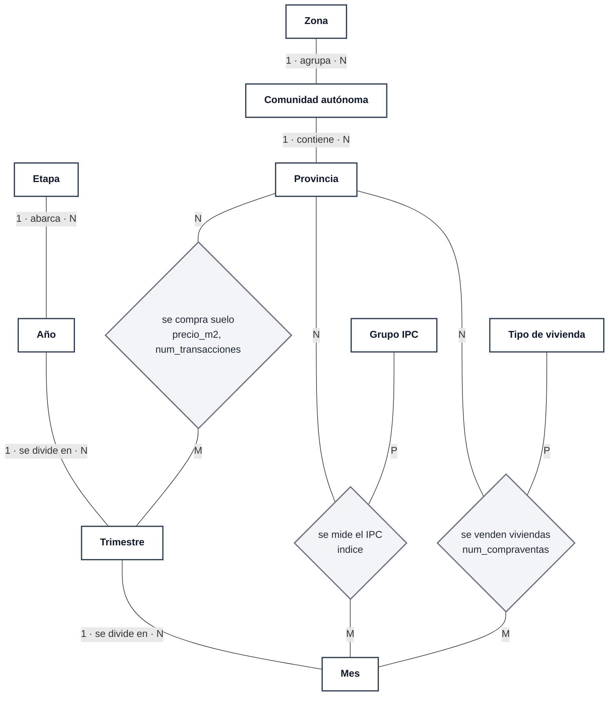
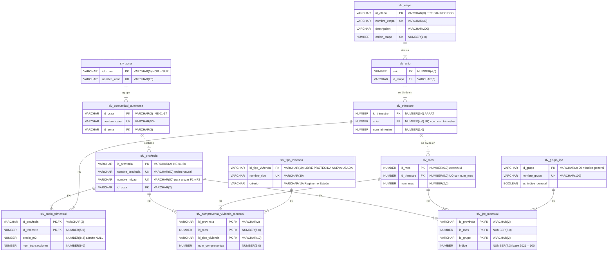
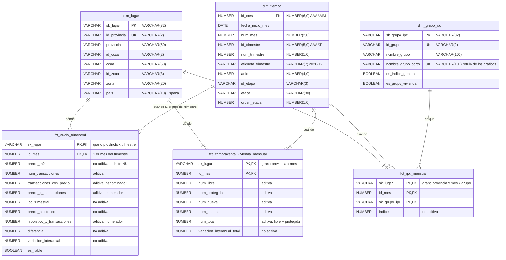

# Diseño del modelo de datos · Suelo urbano frente al IPC en España (2018-2025)

Diseño del modelo de datos del proyecto: modelo conceptual, lógico y físico de Silver, normalización de 1FN a 3FN, estrella de Gold, diccionario de datos, marts y catálogo de métricas. Todo está implementado en dbt (`models/`); los nombres de este documento son los del código. Los cambios que se hicieron durante la implementación respecto al diseño inicial están en el §8, y el porqué de cada decisión, en [`decisiones.md`](decisiones.md).

**Vocabulario:** se dice "IPC" o "coste de vida", no "inflación".

**Diagramas** (en `documentacion/`; se editan en draw.io y el PNG es la imagen exportada):

| Fichero | Contenido |
|---|---|
| `modelo_conceptual.drawio` y `.drawio.png` | Modelo conceptual (notación de Chen): entidades, relaciones y medidas |
| `modelo_silver_logico.drawio` y `.drawio.png` | Silver: página "Lógico" (12 tablas, PK, FK y UQ) y página "Físico" (con los tipos de Snowflake). El PNG es la página "Lógico" |
| `modelo_gold_estrella.drawio` y `.drawio.png` | Estrella de Gold: 3 hechos y 3 dimensiones. No dibuja `nombre_grupo_corto`, el rótulo que se añadió a `dim_grupo_ipc` durante la implementación (§4.2) |

Los tres siguen el mismo esquema en tres columnas (dónde y qué · medidas · cuándo) y marcan en gris lo que lleva medidas. Este documento incluye además una versión Mermaid de cada modelo, que GitHub dibuja directamente.

---

## 0. Decisiones de diseño

| # | Decisión |
|---|---|
| D1 | **Etapas:** `PRE` prepandemia 2018-2019 · `PAN` pandemia 2020 · `REC` recuperación 2021-2022 · `POS` pospandemia 2023-2025 (la OMS dio por terminada la emergencia sanitaria internacional el 5-may-2023) |
| D2 | Las 3 filas sin precio (`n.s.`: Ávila 2T 2020, Soria 2T 2020, Ourense 2T 2024) se conservan con `precio_m2` nulo |
| D3 | Índice general del IPC = `id_grupo` `'00'` + `es_indice_general` |
| D4 | Zona como tabla propia (`slv_zona`): Silver tiene 12 tablas |
| D5 | `orden_etapa` en `slv_etapa`, para ordenar las etapas en los gráficos |
| D6 | `criterio` (Régimen / Estado) es atributo de `slv_tipo_vivienda`, no entidad |
| D7 | Provincia con 2 nombres: `nombre_provincia` (oficial, en orden natural) y `nombre_mivau` (el del ministerio, para cruzar) |
| D8 | Códigos de tipo de vivienda: `LIBRE`, `PROTEGIDA`, `NUEVA`, `USADA` |
| D9 | Códigos de zona `NOR` / `SUR` y de etapa `PRE` / `PAN` / `REC` / `POS` |
| D10 | Nombres de las 17 CCAA en orden natural (§1.2.3) |
| D11 | Sin columnas técnicas en Silver: `_loaded_at` solo vive en Bronze (freshness). Sin contratos de dbt: los tipos se fijan con `CAST` y las restricciones las vigilan los tests |
| D12 | Gold: 3 hechos (fotos periódicas) y 3 dimensiones; `dim_tiempo` a grano mes; 4 marts como vistas |
| D13 | `fct_suelo_trimestral` guarda también `hipotetico_x_transacciones`, para agregar el precio hipotético con los mismos pesos que el real |
| D14 | Los marts de los casos 1 y 3 llevan una fila por territorio y año en 4 niveles (provincia, CCAA, zona y España), calculados en dbt con `GROUPING SETS`: los KPIs de cada nivel salen de dbt y no de DAX |
| D15 | El IPC **no** se agrega por encima de la provincia (no hay ponderaciones): el caso 4 se ve por provincia. La cifra de España es el IPC Nacional del INE, citada como referencia externa |
| D16 | **Convención de claves:** todas las claves naturales se llaman `id_` (`id_provincia`, `id_ccaa`, `id_grupo`, `id_tipo_vivienda`, `id_zona`, `id_etapa`, `id_trimestre`, `id_mes`) y las subrogadas de Gold, `sk_` |
| D17 | La dimensión de territorio se llama **`dim_lugar`** (pareja natural de `dim_tiempo`: dónde y cuándo), con clave `sk_lugar` |
| D18 | `dim_tiempo` con 10 columnas: fuera lo que no usa ningún caso (`nombre_mes`, `etiqueta_mes`, `es_anio_base` y `es_inicio_trimestre`) |
| D19 | **Efecto composición.** Las medias de España y de las CCAA ponderan con las compraventas de cada año, y cada año se vende más suelo en provincias baratas. Por eso el titular de España es la variación real (precio real e hipotético con los mismos pesos), la lectura principal es por provincia y la cesta fija de 2018 (`analyses/cesta_fija_2018.sql`) sirve de comprobación |

---

## 1. Modelo de Silver (conceptual, lógico y físico)

### 1.1 Modelo conceptual

**9 entidades:**

| Entidad | Qué representa | Identificador | Ocurrencias | De dónde sale |
|---|---|---|---|---|
| Zona | Agrupación Norte / Sur de las CCAA | id_zona | 2 | `seed_provincias` |
| Comunidad autónoma | CCAA con provincias en el análisis | id_ccaa (INE) | 17 | `seed_provincias` |
| Provincia | Unidad territorial básica | id_provincia (INE) | 50 | `seed_provincias` (cruza las 4 fuentes) |
| Grupo IPC | Índice general + 12 grupos de gasto ECOICOP | id_grupo | 13 | F3 |
| Tipo de vivienda | Libre, protegida, nueva, usada | id_tipo_vivienda | 4 | F4 |
| Etapa | Fase del periodo respecto a la pandemia | id_etapa | 4 | `seed_etapas` |
| Año | Año natural | anio | 8 | calendario generado en dbt |
| Trimestre | Trimestre natural | id_trimestre | 32 | calendario generado en dbt |
| Mes | Mes natural | id_mes | 96 | calendario generado en dbt |

Fuentes: F1 precio del suelo (MIVAU, tabla 4), F2 transacciones de suelo (MIVAU, tabla 1), F3 IPC provincial (INE, tabla 50918) y F4 compraventa de viviendas (INE, tabla 6150).

País (España) no es entidad: tiene un único valor y va en Gold como atributo constante de `dim_lugar`.

**Regla para decidir si algo es entidad o atributo:**
- Es **entidad (tabla)** si es un nivel de una jerarquía por la que se analiza (zona, CCAA, etapa, año…) o si tiene atributos propios.
- Es **atributo con lista cerrada** (test `accepted_values`) si solo es una etiqueta que califica a otro catálogo, como `criterio`.

**Relaciones: 5 jerárquicas 1:N y 3 N:M con medidas.**

| Relación | Entidades | Cardinalidad | Ocurrencias reales |
|---|---|---|---|
| agrupa | Zona – CCAA | 1:N | 2 → 17 (Norte 10, Sur 7) |
| contiene | CCAA – Provincia | 1:N | 17 → 50 (7 CCAA uniprovinciales) |
| abarca | Etapa – Año | 1:N | 4 → 8 (2 + 1 + 2 + 3) |
| se divide en | Año – Trimestre | 1:N | exactamente 4 por año |
| se divide en | Trimestre – Mes | 1:N | exactamente 3 por trimestre |
| se compra suelo | Provincia – Trimestre | N:M | 1.600 · `precio_m2`, `num_transacciones` |
| se mide el IPC | Provincia – Mes – Grupo IPC | ternaria | 62.400 · `indice` |
| se venden viviendas | Provincia – Mes – Tipo de vivienda | ternaria | 19.200 · `num_compraventas` |

- **Las medidas son atributos de las relaciones, no de las entidades.** El precio no es "de Madrid" ni "del 2T 2020": es de Madrid en el 2T 2020.
- **Las ternarias no se pueden partir en relaciones de dos.** El índice depende a la vez de provincia, mes y grupo.
- **Las N:M son completas** (existe todo el producto cartesiano), porque son datos estadísticos de panel. Eso da los tests de completitud.
- **Hay 3 combinaciones de suelo sin precio publicado**, pero sus transacciones sí existen (D2).
- **Los 4 tipos de vivienda son dos repartos del mismo total.** En cada provincia y mes, libre + protegida = nueva + usada. El INE no publica el cruce entre los dos repartos (libre y nueva, libre y usada…): por eso es un solo catálogo con `criterio` (D6).

### 1.2 Modelo lógico (12 tablas, 13 claves foráneas)

**Traducción del modelo conceptual al lógico:**
- cada entidad → una tabla;
- cada relación 1:N → una FK en el lado N;
- cada N:M → una tabla que la resuelve, con PK compuesta.

Las 3 tablas que resuelven una N:M van en gris medio en los diagramas.

#### 1.2.1 Tablas

| # | Tabla | Grano (una fila es…) | PK | FK | Filas | Origen |
|---|---|---|---|---|---|---|
| 1 | `slv_zona` | una zona | `id_zona` | — | 2 | `seed_provincias` |
| 2 | `slv_comunidad_autonoma` | una CCAA | `id_ccaa` | `id_zona` | 17 | `seed_provincias` |
| 3 | `slv_provincia` | una provincia | `id_provincia` | `id_ccaa` | 50 | `seed_provincias` |
| 4 | `slv_grupo_ipc` | un grupo de gasto | `id_grupo` | — | 13 | F3 |
| 5 | `slv_tipo_vivienda` | un tipo de vivienda | `id_tipo_vivienda` | — | 4 | F4 |
| 6 | `slv_etapa` | una etapa | `id_etapa` | — | 4 | `seed_etapas` |
| 7 | `slv_anio` | un año | `anio` | `id_etapa` | 8 | calendario + `seed_etapas` |
| 8 | `slv_trimestre` | un trimestre | `id_trimestre` (UQ `anio` + `num_trimestre`) | `anio` | 32 | calendario |
| 9 | `slv_mes` | un mes | `id_mes` (UQ `id_trimestre` + `num_mes`) | `id_trimestre` | 96 | calendario |
| 10 | `slv_suelo_trimestral` | una provincia en un trimestre | (`id_provincia`, `id_trimestre`) | 2 | 1.600 | F1 + F2 |
| 11 | `slv_ipc_mensual` | un grupo de gasto en una provincia y un mes | (`id_provincia`, `id_mes`, `id_grupo`) | 3 | 62.400 | F3 |
| 12 | `slv_compraventa_vivienda_mensual` | un tipo de vivienda en una provincia y un mes | (`id_provincia`, `id_mes`, `id_tipo_vivienda`) | 3 | 19.200 | F4 |

**Total: 83.426 filas.** El calendario (`int_calendario_mensual`) se genera con `dbt_utils.date_spine` entre `anio_inicio` y `anio_fin`.

**Convención de nombres (D16):**
- **`id_`**: clave natural, la que identifica la fila en Silver, tanto si viene de la fuente (código del INE) como si la definimos nosotros (`NOR`, `PRE`, AAAAMM). Todas las PK y FK usan el mismo prefijo.
- **`sk_`**: clave subrogada que se genera en Gold (`dim_lugar`, `dim_grupo_ipc`).
- **`nombre_`**: texto para mostrar.
- **`num_`**: conteo o número de orden.

**Formato de las claves:**
- `id_provincia` (`01`-`50`) e `id_ccaa` (`01`-`17`): códigos oficiales del INE como texto de 2 caracteres.
- `id_trimestre` = AAAAT (`20202` = 2T 2020) e `id_mes` = AAAAMM (`202005`): enteros.
- Códigos cortos de texto: `id_grupo` `00`-`12`, `id_zona`, `id_etapa` e `id_tipo_vivienda`.

#### 1.2.2 Catálogos que salen de las fuentes

**`slv_grupo_ipc`:** nombres tal como los publica el INE en la tabla 50918.

| id_grupo | nombre_grupo | es_indice_general |
|---|---|---|
| 00 | Índice general (en F3 viene sin código) | TRUE |
| 01 | Alimentos y bebidas no alcohólicas | FALSE |
| 02 | Bebidas alcohólicas y tabaco | FALSE |
| 03 | Vestido y calzado | FALSE |
| 04 | Vivienda, agua, electricidad, gas y otros combustibles | FALSE |
| 05 | Muebles, artículos del hogar y artículos para el mantenimiento corriente del hogar | FALSE |
| 06 | Sanidad | FALSE |
| 07 | Transporte | FALSE |
| 08 | Comunicaciones | FALSE |
| 09 | Ocio y cultura | FALSE |
| 10 | Enseñanza | FALSE |
| 11 | Restaurantes y hoteles | FALSE |
| 12 | Otros bienes y servicios | FALSE |

⚠️ El grupo 04 **no** incluye la compra de vivienda: el IPC solo recoge el alquiler y los suministros. En Gold se rotula "Vivienda (alquiler y suministros)" (`nombre_grupo_corto`, §4.2).

**`slv_tipo_vivienda`:**
- `nombre_tipo` es la etiqueta del INE tal cual;
- el código y el criterio los asigna el diseño;
- `Viviendas: Total` no entra, porque se calcula.

| id_tipo_vivienda | nombre_tipo (F4) | criterio |
|---|---|---|
| LIBRE | Vivienda libre | Régimen |
| PROTEGIDA | Vivienda protegida | Régimen |
| NUEVA | Vivienda nueva | Estado |
| USADA | Vivienda usada | Estado |

#### 1.2.3 Seeds

**`seed_provincias` (50 filas, 7 columnas):** `id_provincia`, `nombre_provincia`, `nombre_mivau`, `id_ccaa`, `nombre_ccaa`, `id_zona`, `nombre_zona`. Todas se cargan como texto (`column_types` en `seeds/_seeds.yml`), para que `01` no se convierta en `1`.
- Es una tabla de correspondencia **desnormalizada a propósito** (cómoda de mantener a mano). Silver la normaliza en 3 tablas: es el ejemplo de 3FN de la parte 2.
- **`nombre_provincia`:** la etiqueta del INE, salvo 4 provincias que se escriben en orden natural: `07` Illes Balears, `15` A Coruña, `26` La Rioja y `35` Las Palmas.
- **`nombre_mivau`:** el nombre exacto del Excel del ministerio, sin los espacios finales pero con los interiores. Ojo: `Asturias (Principado de )` lleva un espacio antes del paréntesis.

**CCAA y zona** (códigos oficiales del INE, comprobados contra F4):

| id_ccaa | nombre_ccaa | id_zona | | id_ccaa | nombre_ccaa | id_zona |
|---|---|---|---|---|---|---|
| 01 | Andalucía | SUR | | 10 | Comunitat Valenciana | SUR |
| 02 | Aragón | NOR | | 11 | Extremadura | SUR |
| 03 | Principado de Asturias | NOR | | 12 | Galicia | NOR |
| 04 | Illes Balears | SUR | | 13 | Comunidad de Madrid | NOR |
| 05 | Canarias | SUR | | 14 | Región de Murcia | SUR |
| 06 | Cantabria | NOR | | 15 | Comunidad Foral de Navarra | NOR |
| 07 | Castilla y León | NOR | | 16 | País Vasco | NOR |
| 08 | Castilla-La Mancha | SUR | | 17 | La Rioja | NOR |
| 09 | Cataluña | NOR | | | | |

`NOR` = Norte (10 CCAA, 28 provincias) y `SUR` = Sur (7 CCAA, 22 provincias): una agrupación sencilla en dos zonas para comparar el norte y el sur.

**`seed_etapas` (4 filas):** `id_etapa`, `nombre_etapa`, `descripcion`, `orden_etapa`, `anio_desde`, `anio_hasta`. Los años solo viven aquí; Silver los expresa con la FK `slv_anio.id_etapa`.

| id_etapa | nombre_etapa | orden_etapa | anio_desde | anio_hasta | descripcion |
|---|---|---|---|---|---|
| PRE | Prepandemia | 1 | 2018 | 2019 | Antes de la COVID-19 |
| PAN | Pandemia | 2 | 2020 | 2020 | Año del confinamiento y de las restricciones más duras |
| REC | Recuperación | 3 | 2021 | 2022 | Rebote de la actividad y retirada progresiva de las restricciones |
| POS | Pospandemia | 4 | 2023 | 2025 | Desde el fin de la emergencia sanitaria internacional (OMS, 5-may-2023) |

Los ficheros están en `seeds/` (UTF-8 sin BOM, separados por comas). Sus tests comprueban códigos únicos, nombres únicos, zonas válidas, que el código y el nombre de la zona casan y que `anio_desde` ≤ `anio_hasta`. El cruce 50 de 50 con las fuentes lo confirman los tests de completitud.

### 1.3 Modelo físico (Snowflake)

**Dónde vive cada objeto:**

| Objeto | Base de datos y esquema | Materialización |
|---|---|---|
| Vistas `stg_` (`models/staging/`) | `{ENV}_SILVER_DB.staging` | view |
| Vistas `int_` de 1FN (`models/silver/intermediate/`) | `{ENV}_SILVER_DB.silver` | view |
| 12 tablas `slv_` | `{ENV}_SILVER_DB.silver` | table (carga completa); `slv_compraventa_vivienda_mensual`, incremental con `merge` (§6) |
| Seeds | `{ENV}_SILVER_DB.seeds` | seed |
| Snapshot `snp_compraventa_vivienda` | `{ENV}_SILVER_DB.snapshots` | snapshot SCD2 (`check` sobre `num_compraventas`) |

**Cómo se implementa sin contratos de dbt:**
- Los **tipos** se fijan con un `CAST` explícito en cada modelo `slv_`, con el tipo exacto del diccionario (§4). Como dbt crea la tabla a partir del `SELECT`, la tabla nace con esos tipos.
- **NOT NULL, PK, FK, UNIQUE y CHECK** no se declaran en Snowflake: los vigilan los tests de dbt indicados en el diccionario.
- El modelo físico queda documentado en el diagrama `modelo_silver_logico.drawio` (página "Físico") y en el diccionario del §4.

**Decisiones físicas:**

| Decisión | Por qué |
|---|---|
| Códigos del INE como `VARCHAR(2)` | `01` no es `1`. Como número perdería el cero y no cruzaría con el texto del INE (`01 Araba/Álava`). Además, nunca se opera con ellos |
| Claves de tiempo como `NUMBER` (AAAAT, AAAAMM), no `DATE` | Ordenan bien, se leen a simple vista y el cruce entre enteros es barato. Un trimestre no es un día |
| Medidas decimales en `NUMBER`, nunca `FLOAT` | `FLOAT` es aproximado, y las sumas y medias acumularían errores. `NUMBER` es exacto |
| `precio_m2 NUMBER(8,2)` | Rango real de 18,15 a 726,19 €/m². El perfilado de Bronze (`snowflake/03c_perfilado_bronze.sql`) mide el número máximo de decimales del fichero convertido |
| `indice NUMBER(7,3)` | El INE publica 3 decimales (`119,942`) |
| Conteos `NUMBER(9,0)` | En Snowflake la precisión declarada no cambia lo que ocupa el dato; el rango lo vigila un test |
| `VARCHAR` ajustado en los códigos | No ahorra espacio, pero hace de regla: un código de 3 caracteres no entra en `VARCHAR(2)` y el `CAST` falla en vez de guardar un dato malo |
| `precio_m2` es la única columna de Silver que admite nulos | D2 |
| Sin claves subrogadas ni `AUTOINCREMENT` en Silver | Las fuentes traen claves oficiales y estables (INE) o deterministas (AAAAMM). Las subrogadas van en Gold |
| Sin `_loaded_at` en Silver | `_loaded_at` vive en Bronze para el freshness. El incremental de vivienda no la necesita: filtra por el mes del dato (`id_mes`), porque Bronze sustituye el fichero completo en cada entrega y `_loaded_at` cambia en todas las filas (§6) |

### 1.4 Registro de decisiones de Silver (claves, origen, redundancia)

| Decisión | Regla | Por qué (con datos reales) |
|---|---|---|
| La clave de provincia y de CCAA es el código del INE, no el nombre | Claves | Cada fuente escribe distinto el mismo sitio: `Vizcaya` / `48 Bizkaia`, `Avila` / `05 Ávila`, `Guipúzcoa` / `20 Gipuzkoa` |
| El ministerio se traduce con `seed_provincias.nombre_mivau` | Origen | El Excel no trae códigos: se cruza por el nombre exacto, quitando los espacios finales (`'Almería           '`) |
| Nunca se cruza por un código sin saber de qué nivel es | Claves | En F4, `09` es Cataluña (CCAA) y también Burgos (provincia) |
| Las provincias salen del seed y el calendario de `date_spine`, no de los datos | Origen | Los catálogos no dependen de que lleguen datos: si a una fuente le faltara un periodo, el test de completitud lo detecta |
| UQ (`anio`, `num_trimestre`) y UQ (`id_trimestre`, `num_mes`) | Claves | Son claves candidatas compuestas |
| No se guardan el total nacional, las filas de CCAA ni `Viviendas: Total` | Redundancia | Se calculan sumando provincias: la suma cuadra con el total nacional (2T 2025: 7.437) y libre + protegida = nueva + usada = total en el 100 % de los casos. Solo se usan en tests de conciliación |
| Sí se guarda el Índice general (`00`) | Redundancia (excepción) | Es un total de los 12 grupos, pero no se puede recalcular: faltan las ponderaciones del INE |
| El IPC `Nacional` y Ceuta y Melilla se quedan en Bronze | Redundancia / alcance | España = suma de las 50 provincias. Ceuta y Melilla van juntas en la tabla 4 del ministerio, con 29 huecos |
| No se guardan las variaciones publicadas | Redundancia | Las 3 variaciones del INE y las 2 del ministerio se pueden calcular a partir del índice o del precio; se calculan en Gold |
| Precio `n.s.` → nulo | Nulos | Las transacciones de esos trimestres existen (2 de ellas en el 2T 2020, el peor trimestre). Un 0 hundiría las medias, e interpolar sería inventar el dato |
| Zona como tabla | Diseño | La 3FN prohíbe tenerla en la provincia, pero no obliga a hacer tabla. Es tabla porque es un nivel de análisis (Norte frente a Sur) y la FK impide zonas que no existen |
| `criterio` como atributo | Diseño | Solo tiene 2 valores, ningún atributo propio, y en Gold desaparece (los tipos van en columnas) |
| `orden_etapa` | Diseño | Ni los códigos (`PAN, POS, PRE, REC`) ni los nombres de las etapas salen en orden alfabéticamente |
| Un solo nombre para mostrar | Redundancia | La etiqueta del INE y el "nombre común" coincidían en 46 de 50 provincias |
| Códigos de vivienda en palabras | Diseño | `PRO` se confundía con el entorno PRO. Además, el bucle Jinja de Gold genera `num_libre`… a partir del propio código |
| Todas las claves naturales con prefijo `id_` | Claves | Una sola regla para todas las tablas. Que `id_provincia` venga del INE se documenta en su descripción. Sigue siendo texto: `01` no es `1` |
| Claves subrogadas `sk_` solo en las dimensiones de Gold | Claves | Gold queda aislado de la numeración de la fuente y se usa `generate_surrogate_key` de `dbt_utils`. La clave natural se conserva como atributo |

---

## 2. Normalización 1FN → 3FN

### 2.1 Dónde ocurre cada forma normal

| Capa | Modelos | Qué hace |
|---|---|---|
| Staging | `stg_` (vistas, 1:1 con Bronze) | Limpia el formato: `TRIM`, números con `FN_TEXTO_A_NUMERO`, periodos con `FN_PERIODO_INE_A_FECHA`. Todavía no normaliza |
| Silver intermedio | `int_` (vistas) | **1FN:** valores atómicos, sin grupos repetitivos ni niveles mezclados |
| Silver | `slv_` (tablas) | **2FN y 3FN:** cada dato en la tabla de la clave de la que depende |

### 2.2 Decisiones con los datos sucios reales

| Forma | Problema en el origen (dato real) | Decisión | Modelo |
|---|---|---|---|
| 1FN | **Grupo repetitivo:** F1 y F2 tienen 90 columnas de trimestres (C a CN) en cada fila | Pasar columnas a filas con un bucle Jinja (`unpivot_trimestres`): una fila por territorio y trimestre | `int_mivau__suelo_trimestral_1fn` |
| 1FN | **La cabecera no es fiable:** el 4T 2023 no tiene etiqueta en F2, y hay `'Año 2011 '` y `'1º '` con espacios | El periodo se asigna **por posición** de columna: año = 2004 + i div 4, trimestre = i mod 4 + 1 | ídem |
| 1FN | **Filas que no son datos:** títulos (filas 7-10 de Excel) y una cabecera en 3 filas (11-13) | Se descartan por número de fila (`_fila`) | ídem |
| 1FN | **Niveles mezclados en una columna:** `TOTAL NACIONAL`, `Andalucía` (CCAA) y `Almería` (provincia) en la columna B; en F4, filas de nación, CCAA y provincia | Solo quedan las filas que cruzan con el seed (50 provincias). El resto se usa solo para conciliar | `int_` de las 3 fuentes |
| 1FN | **Dos datos en un campo:** `38 Santa Cruz de Tenerife`, `04 Vivienda, agua…` | Macro `separar_codigo_nombre` (la misma para 3 columnas de 2 fuentes). `Índice general` no trae código → `00` | `int_ine__ipc_mensual_1fn`, `int_ine__compraventa_vivienda_1fn` |
| 1FN | **Periodo como texto:** `2025M12` | UDF → `id_mes` 202512 | ídem |
| 1FN | **Valores fuera del dominio numérico:** `n.s.`, `n.s`, `.`; coma decimal (`119,942`) y punto de miles (`54.548`) | `FN_TEXTO_A_NUMERO` → número o NULL | staging |
| 1FN | **Una columna con 4 significados:** en F3, `Total` es índice o una de 3 variaciones según `Tipo de dato` | Solo se queda `Índice`; las variaciones se pueden calcular (§1.4) | `int_ine__ipc_mensual_1fn` |
| 1FN | **Dos clasificaciones en una columna:** `Régimen y estado` | Catálogo de 4 tipos + `criterio`; `Viviendas: Total` fuera | `int_ine__compraventa_vivienda_1fn` |
| 2FN | En la tabla 1FN del IPC (clave provincia + mes + grupo), `nombre_provincia` depende solo de la provincia y `nombre_grupo` solo del grupo: **dependencias parciales**. Además cada fuente escribe distinto la provincia (`Vizcaya` / `Bizkaia`) | Los nombres salen a `slv_provincia` y `slv_grupo_ipc`: un nombre por código | `slv_provincia`, `slv_grupo_ipc` |
| 2FN | `anio` y `num_mes` dependen solo del mes, no de la provincia ni del grupo | Salen a `slv_mes` | `slv_mes` |
| 2FN | `nombre_tipo` y `criterio` dependen solo del tipo | Salen a `slv_tipo_vivienda` | `slv_tipo_vivienda` |
| 2FN | `precio_m2` (F1) y `num_transacciones` (F2) dependen de la clave completa (provincia + trimestre) | Van juntos en la misma tabla, aunque vengan de dos ficheros | `slv_suelo_trimestral` |
| 3FN | **provincia → CCAA → zona:** en el seed, las 9 provincias de Castilla y León repiten `Castilla y León` y `Norte`. Además las fuentes escriben distinto la CCAA (`Castilla - La Mancha` en F4, `Castilla-La Mancha` en el ministerio; `Balears, Illes` / `Balears (Illes)`) | Un nombre por código en `slv_comunidad_autonoma`, y la zona en `slv_zona` | 3 tablas desde 1 seed |
| 3FN | **mes → trimestre → año → etapa:** en un calendario plano, `num_mes` determina `num_trimestre` (abril siempre es T2) y el año determina la etapa | Cada regla en su tabla: cambiar la etapa de un año es cambiar 1 fila de `slv_anio`, no 12 meses | `slv_mes` → `slv_trimestre` → `slv_anio` → `slv_etapa` |

### 2.3 Comprobación final

En las 12 tablas `slv_`, cada columna que no es clave depende de **toda la clave y solo de ella**.
- Ninguna tabla de medidas guarda nombres ni atributos de periodo.
- Ninguna tabla de catálogo guarda datos de su "abuelo": `slv_provincia` no tiene la zona y `slv_mes` no tiene el año.
- Los totales que se pueden calcular están fuera.

---

## 3. Gold: esquema en estrella

### 3.1 Qué tipo de modelo es

- **Los hechos son fotos periódicas** (*periodic snapshot*, en Kimball), no transacciones.
  - Cada fila es la medición de una provincia en un periodo, como el saldo de una cuenta a fin de mes.
  - No hay compraventas individuales: lo más detallado que publican las fuentes es provincia × mes o trimestre, y no se inventa nada por debajo.
  - El grano de cada hecho es "una provincia en un trimestre" (suelo), "una provincia en un mes" (vivienda) y "un grupo de gasto en una provincia y un mes" (IPC).
- **¿Por qué el precio medio es un hecho y no un atributo de la provincia?**
  - Una dimensión describe y sirve para filtrar o agrupar.
  - El precio cambia cada trimestre y es justo lo que se analiza (se agrega con pesos, se compara, se sigue en el tiempo). La provincia no "tiene" un precio: tiene uno distinto cada trimestre.
  - Ponerlo en la dimensión exigiría una columna por trimestre, que es el Excel del ministerio otra vez.
- **¿Por qué 3 hechos?** Kimball: un hecho por proceso y por grano.
  - Aquí hay 3 fuentes, 3 granos y 3 ritmos de publicación.
  - Juntarlos obligaría a inventar meses de suelo, o repetiría cada dato de vivienda 13 veces (una por grupo).
- **¿Por qué no más dimensiones?** El número de dimensiones sale del grano.
  - Una estadística oficial se publica por lugar, por tiempo y, en el IPC, por grupo de gasto. No hay clientes, productos ni tiendas.
  - El tipo de vivienda no es dimensión: sus dos criterios parten el mismo total en dos, y como dimensión se sumaría dos veces. Va en columnas.
- **Es estrella, no copo de nieve.** CCAA, zona, etapa o año son **niveles de una jerarquía dentro de su dimensión**, no tablas aparte. Sacarlas sería repetir en Gold las tablas de Silver.

### 3.2 Matriz de hechos y dimensiones

| Hecho | Grano | Filas | Materialización | dim_lugar | dim_tiempo | dim_grupo_ipc | Casos |
|---|---|---|---|---|---|---|---|
| `fct_suelo_trimestral` | provincia × trimestre | 1.600 | table | ✔ | ✔ (primer mes del trimestre) | — | 1, 2, 3 |
| `fct_compraventa_vivienda_mensual` | provincia × mes | 4.800 | incremental (`delete+insert`) | ✔ | ✔ | — | 2, 3 |
| `fct_ipc_mensual` | provincia × mes × grupo | 62.400 | table | ✔ | ✔ | ✔ | 4 (y el índice general alimenta el 1) |

Las 3 dimensiones son tablas en `{ENV}_GOLD_DB.core`. `dim_lugar` y `dim_tiempo` son **dimensiones conformadas**: las comparten los 3 hechos. Por eso un filtro de CCAA o de etapa afecta a todo, y los casos 2 y 3 pueden cruzar suelo y vivienda.

### 3.3 Hechos y medidas

**`fct_suelo_trimestral`** (provincia × trimestre, 1.600 filas). Se une a `dim_tiempo` por el **primer mes** del trimestre (enero, abril, julio, octubre) y se analiza siempre por trimestre, año o etapa.
- Ejemplo: el 2T 2020 se guarda con `id_mes` = 202004.
- La unión es siempre por `id_mes` (número), nunca por la fecha.
- Al ver el suelo mes a mes, solo hay valor en enero, abril, julio y octubre. Es lo correcto: el ministerio no publica meses.

| Medida | Definición | ¿Aditiva? |
|---|---|---|
| `precio_m2` | Precio medio publicado (nulo si es `n.s.`) | **No** (es una media) |
| `num_transacciones` | Compraventas de suelo | Sí |
| `transacciones_con_precio` | = `num_transacciones` si hay precio; 0 si no | Sí (denominador) |
| `precio_x_transacciones` | `precio_m2` × `num_transacciones`; 0 si no hay precio | Sí (numerador) |
| `ipc_trimestral` | Media de los 3 meses del Índice general de la provincia | No |
| `precio_hipotetico` | Precio si hubiera subido como el IPC: `precio_base` × `ipc_trimestral` / `ipc_medio_base` | No |
| `hipotetico_x_transacciones` | `precio_hipotetico` × `transacciones_con_precio` | Sí (numerador) |
| `diferencia` | `precio_m2` − `precio_hipotetico` (nula sin precio) | No |
| `variacion_interanual` | Precio frente al mismo trimestre del año anterior − 1 (nula en 2018) | No |
| `es_fiable` | FALSE si `num_transacciones` < 20 (variable `umbral_fiabilidad`) | — (marca) |

- **`precio_base`:** media ponderada del precio de la provincia en el año base (variable `anio_base`, 2018): Σ `precio_x_transacciones` / Σ `transacciones_con_precio`.
- **`ipc_medio_base`:** media del Índice general de esa provincia en el año base.
- Ninguna provincia tiene huecos de precio en 2018.
- La definición completa está en el bloque de documentación `precio_hipotetico` (`docs/conceptos.md`) y la fórmula, en la macro `precio_hipotetico` (`macros/metricas.sql`).

**`fct_compraventa_vivienda_mensual`** (provincia × mes, 4.800 filas):
- Columnas `num_libre`, `num_protegida`, `num_nueva` y `num_usada`, pivotadas con un bucle Jinja sobre los códigos de tipo. Todas aditivas.
- `num_total` = libre + protegida (aditiva). Un test comprueba que también = nueva + usada.
- `variacion_interanual_total`: frente al mismo mes del año anterior; no aditiva; nula en 2018.
- Es incremental: cada ejecución borra y reescribe los meses de la ventana de revisión (§6).

**`fct_ipc_mensual`** (provincia × mes × grupo, 62.400 filas): `indice`, **no aditivo**. Los índices no se suman ni se promedian entre provincias: se comparan sus variaciones.

### 3.4 Dimensiones

| Dimensión | Filas | Clave | Atributos | Jerarquía |
|---|---|---|---|---|
| `dim_lugar` | 50 | `sk_lugar` (subrogada, `generate_surrogate_key` de `id_provincia`) | `id_provincia`, `provincia`, `id_ccaa`, `ccaa`, `id_zona`, `zona`, `pais` | País → Zona → CCAA → Provincia |
| `dim_tiempo` | 96 | `id_mes` (AAAAMM) | `fecha_inicio_mes`, `num_mes`, `id_trimestre`, `num_trimestre`, `etiqueta_trimestre`, `anio`, `id_etapa`, `etapa`, `orden_etapa` | Etapa → Año → Trimestre → Mes |
| `dim_grupo_ipc` | 13 | `sk_grupo_ipc` (subrogada, de `id_grupo`) | `id_grupo`, `nombre_grupo`, `nombre_grupo_corto`, `es_indice_general`, `es_grupo_vivienda` | — |

**Tres tipos de clave en Gold:**
- **`sk_lugar` y `sk_grupo_ipc`: claves subrogadas** (hash de `generate_surrogate_key`). Es la práctica de Kimball:
  - Gold no depende de cómo numera la fuente: si el INE cambiara un código, solo cambiaría el atributo `id_provincia`, no las relaciones;
  - la clave natural se conserva como atributo, con test `unique`.
- **`id_mes`: clave natural de fecha.** Es la excepción clásica de Kimball: una clave AAAAMM es estable, legible y ordena bien, y una subrogada no aportaría nada.
- **Los hechos no tienen clave propia:** su PK es la combinación de sus FK, es decir, su grano.

**Para qué sirve cada columna de `dim_tiempo`** (D18: fuera lo que ningún caso usa)

| Columna | Para qué |
|---|---|
| `id_mes` | Clave: une los 3 hechos |
| `fecha_inicio_mes` | El mismo mes que `id_mes`, pero en tipo DATE (el día 1). Power BI la usa como eje de tiempo continuo. Se llama así, y no `fecha`, para no sugerir que hay datos diarios |
| `num_mes`, `num_trimestre`, `anio` | Niveles de la jerarquía. `num_mes` permite comparar el mismo mes de años distintos (mayo de 2020 frente a mayo de 2019) |
| `id_trimestre`, `etiqueta_trimestre` | El suelo se analiza por trimestre. Un trimestre no tiene tipo fecha, así que necesita una etiqueta para el eje (`2020-T2`), ordenada por `id_trimestre` |
| `id_etapa`, `etapa`, `orden_etapa` | Filtrar y agrupar por etapa. `orden_etapa` hace que Power BI no las ordene alfabéticamente |

**`dim_grupo_ipc`:**
- `es_indice_general` separa la cesta completa (`00`) de sus 12 partes. El mapa del caso 4 usa el Índice general y las barras por grupo lo excluyen; si no, se mezclaría el total con sus partes.
- `es_grupo_vivienda` marca el 04 para destacarlo en el caso 4 sin escribir "04" a mano en Power BI.
- `nombre_grupo_corto` es el rótulo de los gráficos: el nombre del INE, salvo el 04, que se rotula "Vivienda (alquiler y suministros)" para dejar claro que no incluye la compra, y el 05, "Muebles y artículos del hogar". Un rótulo, un sitio: no se escribe en Power BI.

### 3.5 Trampas que se evitan

| Trampa | Qué saldría mal | Cómo se evita |
|---|---|---|
| Promediar `precio_m2` entre provincias o trimestres | Soria (pocas compraventas) pesaría lo mismo que Madrid | Se guardan numerador y denominador, y se divide al final |
| Dejar en el denominador las transacciones sin precio | Media sesgada a la baja: con 10 compraventas a 100 €/m² y 5 sin precio, saldría 66,7 en lugar de 100 | `transacciones_con_precio` |
| Comparar un precio real ponderado con un hipotético sin ponderar | La comparación no es homogénea | Los dos se ponderan con los mismos pesos (`hipotetico_x_transacciones`) |
| Sumar los 4 tipos de vivienda | El doble del total | Columnas por tipo + `num_total` |
| Promediar los 13 grupos del IPC | Se mezcla el total con sus partes | `es_indice_general` |
| Promediar el IPC de las provincias para sacar España o una CCAA | No es el IPC oficial: faltan las ponderaciones | El IPC no se agrega (D15) |
| Unir suelo (trimestral) y vivienda (mensual) fila a fila | Cada trimestre se repetiría 3 veces | Primero se agrega cada hecho al nivel común (provincia y año, o trimestre) y después se cruzan |
| Repartir un trimestre entre sus 3 meses | Inventar datos | El suelo solo existe en el primer mes de cada trimestre |

### 3.6 Diagrama

---

## 4. Diccionario de datos

**Cómo leer los tests:**
- `unique` / `not_null`: genéricos.
- `rel → tabla.col`: test `relationships`.
- `acc [ ]`: `accepted_values`.
- `rango`: `dbt_utils.accepted_range`.
- `expr`: `dbt_utils.expression_is_true`.
- `ucc ( )`: `dbt_utils.unique_combination_of_columns`.

Cada test lleva en el YAML una descripción de qué significa el fallo y qué revisar.

### 4.1 Silver

**`slv_zona`** · una fila por zona · 2 filas

| Columna | Tipo | Descripción | Tests |
|---|---|---|---|
| id_zona | VARCHAR(3) | Código de la zona | unique, not_null, acc [NOR, SUR] |
| nombre_zona | VARCHAR(20) | Norte o Sur | unique, not_null |

**`slv_comunidad_autonoma`** · una fila por CCAA · 17 filas

| Columna | Tipo | Descripción | Tests |
|---|---|---|---|
| id_ccaa | VARCHAR(2) | Código oficial del INE (01-17) | unique, not_null |
| nombre_ccaa | VARCHAR(50) | Nombre oficial en orden natural | unique, not_null |
| id_zona | VARCHAR(3) | Zona de la CCAA | not_null, rel → slv_zona.id_zona |

**`slv_provincia`** · una fila por provincia · 50 filas

| Columna | Tipo | Descripción | Tests |
|---|---|---|---|
| id_provincia | VARCHAR(2) | Código oficial del INE (01-50) | unique, not_null |
| nombre_provincia | VARCHAR(50) | Nombre oficial en orden natural (para mostrar y para mapas) | unique, not_null |
| nombre_mivau | VARCHAR(50) | Nombre exacto en los Excel del ministerio, sin espacios finales (para cruzar F1 y F2) | unique, not_null |
| id_ccaa | VARCHAR(2) | CCAA de la provincia | not_null, rel → slv_comunidad_autonoma.id_ccaa |

**`slv_grupo_ipc`** · una fila por grupo de gasto · 13 filas

| Columna | Tipo | Descripción | Tests |
|---|---|---|---|
| id_grupo | VARCHAR(2) | Código ECOICOP; `00` = Índice general (cesta completa) | unique, not_null, acc [00 … 12] |
| nombre_grupo | VARCHAR(100) | Nombre del grupo tal como lo publica el INE | unique, not_null |
| es_indice_general | BOOLEAN | TRUE solo para la cesta completa | not_null, expr `es_indice_general = (id_grupo = '00')` |

**`slv_tipo_vivienda`** · una fila por tipo · 4 filas

| Columna | Tipo | Descripción | Tests |
|---|---|---|---|
| id_tipo_vivienda | VARCHAR(10) | Código del tipo | unique, not_null, acc [LIBRE, PROTEGIDA, NUEVA, USADA] |
| nombre_tipo | VARCHAR(30) | Etiqueta del INE (p. ej. "Vivienda libre") | unique, not_null |
| criterio | VARCHAR(10) | Reparto al que pertenece: Régimen (libre / protegida) o Estado (nueva / usada). Solo se suman tipos del mismo criterio | not_null, acc [Régimen, Estado] |

**`slv_etapa`** · una fila por etapa · 4 filas

| Columna | Tipo | Descripción | Tests |
|---|---|---|---|
| id_etapa | VARCHAR(3) | Código de la etapa | unique, not_null, acc [PRE, PAN, REC, POS] |
| nombre_etapa | VARCHAR(30) | Prepandemia, Pandemia, Recuperación o Pospandemia | unique, not_null |
| descripcion | VARCHAR(200) | Qué cubre la etapa | not_null |
| orden_etapa | NUMBER(1,0) | Orden cronológico, para ordenar gráficos | unique, not_null, rango 1-4 |

**`slv_anio`** · una fila por año · 8 filas

| Columna | Tipo | Descripción | Tests |
|---|---|---|---|
| anio | NUMBER(4,0) | Año natural | unique, not_null, rango `anio_inicio`-`anio_fin` |
| id_etapa | VARCHAR(3) | Etapa del año | not_null, rel → slv_etapa.id_etapa |

**`slv_trimestre`** · una fila por trimestre · 32 filas · ucc (anio, num_trimestre)

| Columna | Tipo | Descripción | Tests |
|---|---|---|---|
| id_trimestre | NUMBER(5,0) | Clave AAAAT (20202 = 2T 2020) | unique, not_null, expr `id_trimestre = anio * 10 + num_trimestre` |
| anio | NUMBER(4,0) | Año del trimestre | not_null, rel → slv_anio.anio |
| num_trimestre | NUMBER(1,0) | Número de trimestre | not_null, rango 1-4 |

**`slv_mes`** · una fila por mes · 96 filas · ucc (id_trimestre, num_mes)

| Columna | Tipo | Descripción | Tests |
|---|---|---|---|
| id_mes | NUMBER(6,0) | Clave AAAAMM (202005 = mayo de 2020) | unique, not_null, expr `MOD(id_mes, 100) = num_mes` |
| id_trimestre | NUMBER(5,0) | Trimestre del mes | not_null, rel → slv_trimestre.id_trimestre, expr `id_trimestre = FLOOR(id_mes / 100) * 10 + CEIL(num_mes / 3)` |
| num_mes | NUMBER(2,0) | Número de mes | not_null, rango 1-12 |

**`slv_suelo_trimestral`** · una provincia en un trimestre · 1.600 filas · ucc (id_provincia, id_trimestre) · completitud 50 × 32

| Columna | Tipo | Descripción | Tests |
|---|---|---|---|
| id_provincia | VARCHAR(2) | Provincia | not_null, rel → slv_provincia.id_provincia |
| id_trimestre | NUMBER(5,0) | Trimestre | not_null, rel → slv_trimestre.id_trimestre |
| precio_m2 | NUMBER(8,2) | Precio medio del m² de suelo urbano vendido en el trimestre (€/m², MIVAU tabla 4). Nulo si el ministerio no lo publica (`n.s.`) | rango > 0; singular "3 nulos esperados" (aviso) |
| num_transacciones | NUMBER(9,0) | Compraventas de suelo urbano (MIVAU tabla 1) | not_null, rango ≥ 0 |

**`slv_ipc_mensual`** · un grupo en una provincia y un mes · 62.400 filas · ucc (id_provincia, id_mes, id_grupo) · completitud 50 × 96 × 13

| Columna | Tipo | Descripción | Tests |
|---|---|---|---|
| id_provincia | VARCHAR(2) | Provincia | not_null, rel → slv_provincia.id_provincia |
| id_mes | NUMBER(6,0) | Mes | not_null, rel → slv_mes.id_mes |
| id_grupo | VARCHAR(2) | Grupo de gasto | not_null, rel → slv_grupo_ipc.id_grupo |
| indice | NUMBER(7,3) | Índice de precios de consumo, base 2021 = 100 (INE tabla 50918) | not_null, rango > 0 |

**`slv_compraventa_vivienda_mensual`** · un tipo en una provincia y un mes · 19.200 filas · incremental (`merge`) · ucc (id_provincia, id_mes, id_tipo_vivienda) · completitud 50 × 96 × 4 · singular "coherencia de vivienda"

| Columna | Tipo | Descripción | Tests |
|---|---|---|---|
| id_provincia | VARCHAR(2) | Provincia | not_null, rel → slv_provincia.id_provincia |
| id_mes | NUMBER(6,0) | Mes (hasta el último que haya publicado el INE) | not_null, rel → slv_mes.id_mes |
| id_tipo_vivienda | VARCHAR(10) | Tipo de vivienda | not_null, rel → slv_tipo_vivienda.id_tipo_vivienda |
| num_compraventas | NUMBER(9,0) | Compraventas de viviendas inscritas en el mes (INE tabla 6150; los últimos meses son provisionales) | not_null, rango ≥ 0 |

**`snp_compraventa_vivienda`** (snapshot):
- **Origen y estrategia:** SCD2 sobre `slv_compraventa_vivienda_mensual`, estrategia `check` sobre `num_compraventas`.
- **Clave:** `unique_key` como lista de 3 columnas: `['id_provincia', 'id_mes', 'id_tipo_vivienda']`.
- **Columnas:** las de Silver más `dbt_scd_id`, `dbt_updated_at`, `dbt_valid_from` y `dbt_valid_to`.
- **Tests:** `dbt_scd_id` unique y not_null, y el singular "una versión vigente": cada clave tiene exactamente una fila con `dbt_valid_to` nulo.

### 4.2 Gold

**`dim_lugar`** · una fila por provincia · 50 filas

| Columna | Tipo | Descripción | Tests |
|---|---|---|---|
| sk_lugar | VARCHAR(32) | Clave subrogada (`generate_surrogate_key` de `id_provincia`) | unique, not_null |
| id_provincia | VARCHAR(2) | Código INE | unique, not_null |
| provincia | VARCHAR(50) | Nombre en orden natural (en Power BI, categoría "Estado o provincia") | unique, not_null |
| id_ccaa | VARCHAR(2) | Código INE de la CCAA | not_null |
| ccaa | VARCHAR(50) | Nombre de la CCAA | not_null |
| id_zona | VARCHAR(3) | Código de zona | not_null, acc [NOR, SUR] |
| zona | VARCHAR(20) | Norte o Sur | not_null |
| pais | VARCHAR(10) | Constante "España" (para el mapa) | acc [España] |

**`dim_tiempo`** · una fila por mes · 96 filas

| Columna | Tipo | Descripción | Tests |
|---|---|---|---|
| id_mes | NUMBER(6,0) | Clave AAAAMM | unique, not_null |
| fecha_inicio_mes | DATE | Día 1 del mes, en tipo fecha: eje de tiempo continuo en los gráficos. No es la clave: se une por `id_mes` | unique, not_null |
| num_mes | NUMBER(2,0) | 1-12 | rango 1-12 |
| id_trimestre | NUMBER(5,0) | AAAAT | not_null |
| num_trimestre | NUMBER(1,0) | 1-4 | rango 1-4 |
| etiqueta_trimestre | VARCHAR(7) | "2020-T2" | not_null |
| anio | NUMBER(4,0) | Año | not_null |
| id_etapa | VARCHAR(3) | Código de etapa | acc [PRE, PAN, REC, POS] |
| etapa | VARCHAR(30) | Nombre de la etapa | not_null |
| orden_etapa | NUMBER(1,0) | Para ordenar `etapa` en Power BI ("Ordenar por columna") | rango 1-4 |

**`dim_grupo_ipc`** · una fila por grupo · 13 filas · expr `es_indice_general = (id_grupo = '00')` · expr `es_grupo_vivienda = (id_grupo = '04')`

| Columna | Tipo | Descripción | Tests |
|---|---|---|---|
| sk_grupo_ipc | VARCHAR(32) | Clave subrogada (de `id_grupo`) | unique, not_null |
| id_grupo | VARCHAR(2) | Código ECOICOP (`00` = Índice general) | unique, not_null |
| nombre_grupo | VARCHAR(100) | Nombre del grupo de gasto (INE) | not_null |
| nombre_grupo_corto | VARCHAR(100) | Rótulo para los gráficos (04: "Vivienda (alquiler y suministros)"; 05: "Muebles y artículos del hogar") | unique, not_null |
| es_indice_general | BOOLEAN | TRUE solo en la cesta completa | (expr del modelo) |
| es_grupo_vivienda | BOOLEAN | TRUE solo en el 04: alquiler y suministros, no la compra | (expr del modelo) |

**`fct_suelo_trimestral`** · una provincia en un trimestre · 1.600 filas · ucc (sk_lugar, id_mes) · umbrales de fiabilidad

| Columna | Tipo | Descripción | Tests |
|---|---|---|---|
| sk_lugar | VARCHAR(32) | Provincia | not_null, rel → dim_lugar.sk_lugar |
| id_mes | NUMBER(6,0) | Primer mes del trimestre | not_null, rel → dim_tiempo.id_mes, expr `MOD(id_mes, 100) IN (1, 4, 7, 10)` |
| precio_m2 | NUMBER(8,2) | Precio medio del m² (no aditiva; nula si `n.s.`) | rango > 0 |
| num_transacciones | NUMBER(9,0) | Compraventas de suelo (aditiva) | not_null, rango ≥ 0 |
| transacciones_con_precio | NUMBER(9,0) | Transacciones del trimestre si hay precio, 0 si no (denominador de las medias ponderadas) | not_null, expr `transacciones_con_precio = IFF(precio_m2 IS NULL, 0, num_transacciones)` |
| precio_x_transacciones | NUMBER(14,2) | `precio_m2` × `num_transacciones`, 0 si no hay precio (numerador) | not_null, rango ≥ 0 |
| ipc_trimestral | NUMBER(10,4) | Media de los 3 meses del Índice general de la provincia | not_null, rango > 0 |
| precio_hipotetico | NUMBER(10,2) | Precio si hubiera subido como el IPC desde el año base | not_null, rango > 0 |
| hipotetico_x_transacciones | NUMBER(14,2) | `precio_hipotetico` × `transacciones_con_precio` (numerador del hipotético ponderado) | not_null, rango ≥ 0 |
| diferencia | NUMBER(10,2) | Real − hipotético. Negativa = el suelo va por detrás del coste de vida | — |
| variacion_interanual | NUMBER(9,4) | Frente al mismo trimestre del año anterior (0,083 = +8,3 %); nula en 2018 | — |
| es_fiable | BOOLEAN | FALSE si hay menos de 20 compraventas (variable `umbral_fiabilidad`) | not_null; expr `es_fiable` con aviso si fallan más de 200 filas y error si fallan más de 400 |

**`fct_compraventa_vivienda_mensual`** · una provincia en un mes · 4.800 filas · incremental (`delete+insert`) · ucc (sk_lugar, id_mes) · expr `num_total = num_nueva + num_usada`

| Columna | Tipo | Descripción | Tests |
|---|---|---|---|
| sk_lugar | VARCHAR(32) | Provincia | not_null, rel → dim_lugar.sk_lugar |
| id_mes | NUMBER(6,0) | Mes | not_null, rel → dim_tiempo.id_mes |
| num_libre | NUMBER(9,0) | Compraventas de vivienda libre | not_null, rango ≥ 0 |
| num_protegida | NUMBER(9,0) | Compraventas de vivienda protegida | not_null, rango ≥ 0 |
| num_nueva | NUMBER(9,0) | Compraventas de vivienda nueva | not_null, rango ≥ 0 |
| num_usada | NUMBER(9,0) | Compraventas de vivienda usada | not_null, rango ≥ 0 |
| num_total | NUMBER(9,0) | Total = libre + protegida | not_null |
| variacion_interanual_total | NUMBER(9,4) | Frente al mismo mes del año anterior; nula en 2018 | — |

**`fct_ipc_mensual`** · un grupo en una provincia y un mes · 62.400 filas · ucc (sk_lugar, id_mes, sk_grupo_ipc)

| Columna | Tipo | Descripción | Tests |
|---|---|---|---|
| sk_lugar | VARCHAR(32) | Provincia | not_null, rel → dim_lugar.sk_lugar |
| id_mes | NUMBER(6,0) | Mes | not_null, rel → dim_tiempo.id_mes |
| sk_grupo_ipc | VARCHAR(32) | Grupo de gasto | not_null, rel → dim_grupo_ipc.sk_grupo_ipc |
| indice | NUMBER(7,3) | Índice, base 2021 = 100 (no aditivo) | not_null, rango > 0 |

### 4.3 Tests singulares, de umbral y de fuente

| Test | Comprueba | Gravedad | Si falla… |
|---|---|---|---|
| `assert_completitud_suelo_trimestral` | Cada provincia tiene transacciones en los 32 trimestres (1.600 filas) | error | Falta una provincia o un periodo: revisar el cruce con el seed (`nombre_mivau` con un espacio o una tilde distintos) o el filtro de años |
| `assert_completitud_ipc_mensual` | Cada provincia y grupo tiene índice en los 96 meses (62.400 filas) | error | Revisar el filtro de tipo de dato y el cruce por código de provincia |
| `assert_completitud_compraventa_vivienda` | Cada provincia y tipo tiene compraventas en los 96 meses (19.200 filas) | error | Revisar el filtro de provincia, el cruce con el seed y los códigos de tipo |
| `assert_conciliacion_transacciones_suelo` | Σ 50 provincias + Ceuta y Melilla = `TOTAL NACIONAL` de F2, trimestre a trimestre | error | Columna desplazada en el paso a filas por posición, o una fila de nivel mal filtrada |
| `assert_conciliacion_precio_suelo` | Media ponderada de las 50 provincias frente al `TOTAL NACIONAL` de F1, ±3 % | aviso | Revisar los pesos o un precio mal convertido (coma o punto) |
| `assert_coherencia_compraventa_vivienda` | Libre + protegida = nueva + usada = `Viviendas: Total` del INE, por provincia y mes (tipos desde Silver, total desde staging) | error | El INE ha cambiado una etiqueta de tipo o falta el total de un mes |
| `assert_precio_m2_nulos_esperados` | Exactamente 3 nulos (Ávila y Soria 2T 2020, Ourense 2T 2024) | aviso | Hay un `n.s.` nuevo en el ministerio o falla la UDF de números |
| `assert_snapshot_una_version_vigente` | Por clave, una sola fila con `dbt_valid_to` nulo | error | Con 0, ejecutar el snapshot; con 2 o más, revisar la clave del snapshot o duplicados en Silver |
| Marca de fiabilidad (`fct_suelo_trimestral`) | Trimestres poco fiables (hoy 169 de 1.600) | aviso si > 200, error si > 400 | Si da error en PRO, no se reconstruyen los marts que dependen del hecho y Power BI conserva la última versión buena |
| Freshness de las fuentes | `_loaded_at` en Bronze: aviso a los 35 días, error a los 100 | aviso / error | Toca descargar y cargar la nueva publicación |

Además, las fuentes tienen tests sobre las columnas que usan los filtros (`_fila` única, valores aceptados de `Tipo de dato` y de `Régimen y estado`, columnas obligatorias), las vistas `int_` comprueban su grano y 8 tests guardan sus filas fallidas en el esquema `dbt_jobs` (`store_failures`).

---

## 5. Casos de uso, marts y métricas

**Reglas comunes:**
- Los `mart_` son **vistas** en `{ENV}_GOLD_DB.marts`.
- Llevan sus propias columnas de territorio y tiempo: en Power BI se usan solos, sin relacionarlos con las dimensiones (así no hay relaciones ambiguas).
- Guardan **numerador y denominador** junto a cada ratio.

**Niveles de territorio** (columna `nivel`; bloque de documentación `nivel_territorio`):

| `nivel` | Territorios | Marts |
|---|---|---|
| Provincia | 50 | los 3 |
| CCAA | 17 | casos 1 y 3 |
| Zona | 2 | casos 1 y 3 |
| España (= suma de las 50 provincias) | 1 | los 3 |

Se calculan con `GROUPING SETS` en SQL, y así los KPIs de cada nivel salen de dbt, no de DAX. Los códigos de `id_territorio` se repiten entre niveles (`09` es Burgos como provincia y Cataluña como CCAA; España es `ES`): **siempre se filtra por `nivel`**.

### 5.1 Los 4 casos

| # | Pregunta | Mart y grano | Columnas | Página de Power BI |
|---|---|---|---|---|
| 1 | **¿El suelo sube más que el coste de vida?** ¿Dónde sí y dónde no? | `mart_suelo_vs_ipc` · territorio (4 niveles) × año · 70 × 8 = 560 filas | `nivel`, `id_territorio`, `territorio`, `id_ccaa`, `zona`, `anio`, `id_etapa`; `transacciones_con_precio`, `precio_x_transacciones`, `hipotetico_x_transacciones`; `precio_medio`, `precio_hipotetico`, `diferencia`; `variacion_precio_vs_2018`, `variacion_ipc_vs_2018`, `variacion_real_vs_2018`, `variacion_interanual_precio`; `es_buena_compra`, `es_buena_venta`; `trimestres_poco_fiables` (20 columnas) | "Suelo frente al coste de vida": mapa de la variación real 2018 → 2025 por provincia; España 2025 frente a 2018 (Buena Compra y Buena Venta); línea del precio real frente al hipotético; barras de las 17 CCAA |
| 2 | **La pandemia: caída y rebote** del suelo y la vivienda | `mart_pandemia` · territorio (provincia y España) × mes · 51 × 96 = 4.896 filas. El suelo solo tiene valor en el primer mes de cada trimestre | `nivel`, `id_territorio`, `territorio`, `id_ccaa`, `id_mes`, `fecha_inicio_mes`, `id_trimestre`, `etiqueta_trimestre`, `anio`, `id_etapa`, `etapa`, `orden_etapa`; suelo: `num_transacciones_suelo`, `transacciones_con_precio`, `precio_x_transacciones`, `precio_medio`, `variacion_interanual_precio`, `variacion_interanual_transacciones_suelo`; vivienda: `num_compraventas_vivienda`, `variacion_interanual_compraventas_vivienda` (20 columnas) | "Pandemia: caída y rebote": compraventas y precio del suelo por trimestre; compraventas de vivienda por mes (mayo de 2020 en el subtítulo); las 10 provincias donde más cayó la vivienda en mayo de 2020 |
| 3 | **Mapa del mercado:** ¿dónde es más caro el suelo y dónde se mueve más la vivienda? | `mart_territorio` · territorio (4 niveles) × año · 560 filas | `nivel`, `id_territorio`, `territorio`, `id_ccaa`, `zona`, `anio`; `precio_x_transacciones`, `transacciones_con_precio`, `precio_medio`, `ranking_precio`; `num_transacciones_suelo`, `num_compraventas_vivienda`, `num_nueva`, `num_protegida`, `cuota_nueva`, `cuota_protegida`, `viviendas_por_compraventa_suelo`, `variacion_compraventas_vs_2018` (18 columnas) | "Mapa del mercado": mapa del precio en 2025; las 10 provincias más caras; Norte frente a Sur; tabla de España 2018 frente a 2025 |
| 4 | **Mapa del coste de vida:** ¿dónde y en qué ha subido más? | `mart_coste_vida` · provincia × grupo × año · 50 × 13 × 8 = 5.200 filas. **Solo nivel provincia** (D15) | `id_provincia`, `provincia`, `id_ccaa`, `ccaa`, `zona`, `id_grupo`, `nombre_grupo`, `nombre_grupo_corto`, `es_indice_general`, `es_grupo_vivienda`, `anio`; `ipc_medio_anual`, `variacion_vs_2018`, `variacion_interanual`, `ranking_provincias` (15 columnas) | "Mapa del coste de vida": mapa de la subida del índice general por provincia (con la referencia "España (INE): +22,5 %"); barras de Madrid por grupo, con el 04 destacado |

- **Rankings:** `ranking_precio` (caso 3) va de 1 = el más caro, por nivel y año (en España siempre vale 1). `ranking_provincias` (caso 4) ordena por la subida acumulada frente a 2018, 1 = la que más sube; es nulo en 2018, cuando `variacion_vs_2018` vale 0.
- ⚠️ **Rótulos del caso 1 por encima de la provincia.** En los niveles CCAA, zona y España, `variacion_ipc_vs_2018` es la subida del precio hipotético **ponderada por las compraventas de suelo**. Sirve para comparar el suelo con lo que costaría si hubiera seguido al IPC, pero **no es el IPC oficial** de la CCAA ni de España: se rotula "coste de vida (ponderado por compraventas de suelo)" (D19).
- **Caso 3, cruce de dos hechos** ("drill-across" en Kimball): primero se agrega cada hecho por su cuenta a provincia × año y después se unen por las dimensiones conformadas. Nunca se unen los hechos fila a fila.
- **Caso 2:** el suelo (por trimestre) se coloca en el primer mes del trimestre, y la vivienda va por mes.
- **Tests de los marts:** grano (`ucc`), valores aceptados de `nivel`, `not_null` y valores positivos de las medidas clave, rangos de cuotas y rankings, Buena Compra y el ranking del caso 4 nulos solo en el año base, y el suelo del caso 2 solo en el primer mes del trimestre.

### 5.2 Catálogo de métricas: una métrica, un sitio

**Macros** (`macros/metricas.sql`):

| Macro | Qué calcula |
|---|---|
| `media_ponderada(num, den)` | Σ num / Σ den |
| `ratio(num, den)` | num / den |
| `variacion_pct(actual, anterior)` | actual / anterior − 1 |
| `variacion_real(var_precio, var_ipc)` | (1 + var_precio) / (1 + var_ipc) − 1 |
| `precio_hipotetico(base, ipc, ipc_base)` | base × ipc / ipc_base |

Todas protegen la división entre cero (`NULLIF`).

| Métrica | Definición exacta | ¿Aditiva? | Dónde se calcula | Macro |
|---|---|---|---|---|
| Precio medio del m² | Σ `precio_x_transacciones` / Σ `transacciones_con_precio` | No (se suman numerador y denominador) | marts 1, 2 y 3 | `media_ponderada` |
| IPC trimestral | Media de los 3 índices generales del trimestre | No | `fct_suelo_trimestral` | — |
| Precio hipotético (provincia) | `precio_base` × `ipc_trimestral` / `ipc_medio_base` | No | `fct_suelo_trimestral` | `precio_hipotetico` |
| Precio hipotético (agregado) | Σ `hipotetico_x_transacciones` / Σ `transacciones_con_precio` | No | `mart_suelo_vs_ipc` | `media_ponderada` |
| Diferencia | precio medio − precio hipotético | No | `fct_suelo_trimestral`, `mart_suelo_vs_ipc` | — |
| Variación (frente a 2018 o interanual) | valor / valor de referencia − 1 | No | `fct_` y `mart_` | `variacion_pct` |
| Subida del coste de vida (caso 1) | precio hipotético del año / el de 2018 − 1, con los mismos pesos que el precio | No | `mart_suelo_vs_ipc` | `variacion_pct` |
| Variación real (descontado el coste de vida) | (1 + variación del precio) / (1 + variación del coste de vida) − 1 | No | `mart_suelo_vs_ipc` | `variacion_real` |
| Buena Compra (principal) | §5.3 | — | `mart_suelo_vs_ipc` | — |
| Buena Venta (secundario) | §5.3 | — | `mart_suelo_vs_ipc` | — |
| Viviendas por compraventa de suelo | Σ `num_total` / Σ `num_transacciones` | No (cociente de aditivas) | `mart_territorio` | `ratio` |
| Cuota de vivienda nueva / protegida | Σ `num_nueva` (o `num_protegida`) / Σ `num_total` | No | `mart_territorio` | `ratio` |
| Crecimiento de la actividad de vivienda | compraventas del año / las de 2018 − 1 | No | `mart_territorio` | `variacion_pct` |
| Subida del coste de vida (caso 4) | IPC medio del año / IPC medio de 2018 − 1, por provincia y grupo | No | `mart_coste_vida` | `variacion_pct` |
| Fiabilidad | `num_transacciones` ≥ 20 en el trimestre | — | `fct_suelo_trimestral` | — |

### 5.3 KPIs Buena Compra y Buena Venta (calculados en dbt)

Se calculan por territorio (los 4 niveles) y año en `mart_suelo_vs_ipc`, con `precio_medio` y `precio_hipotetico` ponderados por `transacciones_con_precio`. La fórmula vive en dbt y no en DAX.

- **Buena Compra (KPI principal):** `es_buena_compra = precio_medio < precio_hipotetico`.
  - Lectura: "el suelo cuesta menos de lo que costaría si desde 2018 hubiera subido como el coste de vida".
- **Buena Venta (KPI secundario):** `es_buena_venta = diferencia(año) > diferencia(año anterior)`.
  - Lectura: "la posición del suelo frente al coste de vida ha mejorado respecto al año anterior". Es bueno para quien vende.
- **2018 es el año base:** por construcción, el hipotético ≈ el real, así que los dos KPIs son nulos en 2018 y se leen desde 2019.
- **España en 2025:**
  - real 171,9 frente a hipotético 177,7 €/m² → **Buena Compra = sí**;
  - diferencia −5,8 frente a −8,8 en 2024 → **Buena Venta = sí**.
- En provincias con `trimestres_poco_fiables` > 0 el dato se lee con el aviso de fiabilidad.

### 5.4 Reglas para Power BI

- **Sin lógica de negocio en DAX.** Las medidas son de 4 tipos: leer la cifra del mart (`SELECTEDVALUE`), sumar conteos (`SUM`), dividir sumas (`DIVIDE(SUM(numerador), SUM(denominador))`, solo en la página "Explorar") y presentación (Sí / No). Nunca `AVERAGE` de `precio_m2`, de `indice`, de cuotas ni de variaciones.
- **Cada visual lee una sola fila por punto**, con el `nivel` filtrado: si hubiera más de una, `SELECTEDVALUE` devuelve vacío en lugar de un número falso.
- **Filtros fijos por visual** en las páginas de casos (nivel, año, provincia o índice general) e interacciones entre visuales desactivadas: los marts no tienen relaciones.
- **Ordenación:** `etapa` por `orden_etapa` y `etiqueta_trimestre` por `id_trimestre`.
- **Mapas (Azure Maps):** `territorio` (casos 1 y 3) o `provincia` (caso 4) con la categoría "Estado o provincia" y una columna `PAIS` ("España") añadida en Power Query a los marts, para dar el país como contexto. Sin ella, los nombres que existen en otros países (Córdoba) se situaban fuera de España.
- **Rótulos:** "IPC" o "coste de vida"; el grupo 04, "Vivienda (alquiler y suministros)" (`nombre_grupo_corto`).

---

## 6. Carga incremental de la rama de vivienda

La tabla 6150 del INE llega cada mes como un fichero completo, con meses nuevos y con los últimos 12 meses corregidos (datos provisionales). Suelo e IPC son series cerradas y pequeñas para 2018-2025 y van con carga completa en todas las capas.

| Capa | Modelo | Estrategia | Clave |
|---|---|---|---|
| Bronze | `INE.COMPRAVENTA_VIVIENDAS` | `TRUNCATE` + `COPY` (la entrega tal como llega) | — |
| Staging e intermedio | `stg_ine__compraventa_viviendas`, `int_ine__compraventa_vivienda_1fn` | vistas | — |
| Silver | `slv_compraventa_vivienda_mensual` | incremental, `merge` | `['id_provincia', 'id_mes', 'id_tipo_vivienda']` |
| Gold | `fct_compraventa_vivienda_mensual` | incremental, `delete+insert` | `['sk_lugar', 'id_mes']` (el grano) |
| Marts | `mart_pandemia`, `mart_territorio` | vistas | — |

- **Ventana de revisión:** la macro `ventana_revision(this)`, dentro de `is_incremental()`, devuelve el último `id_mes` de la propia tabla menos `meses_revision` (12). Se suma al filtro 2018-2025. Con 202512 como último mes cargado, la ventana empieza en 202412.
- **Se filtra por el mes del dato, no por la fecha de carga:** Bronze sustituye el fichero completo y `_loaded_at` cambia en todas las filas, así que filtrar por `_loaded_at` mayor que el máximo procesaría todo.
- **Silver solo crea los meses del calendario hasta el último publicado por el INE.** Un hueco dentro de lo publicado sigue saliendo como NULL y lo detectan los tests de completitud y `not_null`.
- **Gold:** la variación interanual (LAG de 12 meses) se calcula con toda la historia de Silver y la ventana se filtra al final, para que el primer mes de la ventana tenga su año anterior.
- **`on_schema_change: append_new_columns`** en los dos modelos: si se añade una columna, se añade a la tabla sin parar el job.
- **La cadena es coherente:** después de la primera capa incremental (Silver) todo es incremental (Gold) o vista (marts). Nunca hay una carga completa detrás de un incremental.
- **`--full-refresh`:** si cambia la lógica o las columnas de esos modelos, si cambian `anio_inicio`, `anio_fin` o `meses_revision`, si el INE revisa datos más antiguos que la ventana o para reparar una tabla. No toca el snapshot.
- **Incremental y snapshot se complementan:** el incremental guarda el último valor publicado; el snapshot (`snp_compraventa_vivienda`), cada versión.

---

## 7. Comprobaciones al cargar Bronze

Las dudas que dejó el diseño se resolvieron al cargar y perfilar Bronze (`snowflake/03c_perfilado_bronze.sql` y [`data/README.md`](../data/README.md)):

1. **Decimales de `precio_m2`:** el perfilado mide el máximo de decimales del CSV convertido; el modelo usa `NUMBER(8,2)` y la conciliación del precio con la media nacional (±3 %) pasa.
2. **Nombres de los 12 grupos ECOICOP:** son los de la tabla del §1.2.2, tal como los publica el INE.
3. **Etiquetas de las CCAA en F4:** los códigos del seed casan con los del INE y cada provincia cae en su comunidad.
4. **Significado de `n.s.`:** el fichero no trae nota que lo explique. Se dice "el ministerio no publica precio".

---

## 8. Cambios respecto al diseño inicial

| Cambio | Motivo |
|---|---|
| Las vistas `int_` van en `models/silver/intermediate/` (esquema `silver`) | Son la parte 1FN de Silver: se seleccionan con la capa |
| Los diagramas van directamente en `documentacion/`; el de Silver se llama `modelo_silver_logico.drawio` (con las páginas "Lógico" y "Físico") | Una sola carpeta de documentación |
| `mart_pandemia` usa `variacion_interanual_…` en lugar de `var_…` | Los mismos nombres que en el caso 1 |
| `ranking_precio`: 1 = el más caro, también en CCAA y zona | El diseño no fijaba la dirección |
| `ranking_provincias`: por la subida acumulada frente a 2018, 1 = la que más sube, nulo en 2018; `variacion_vs_2018` = 0 en 2018 | En el año base no hay subida que ordenar |
| `nombre_grupo_corto` en `dim_grupo_ipc` y `mart_coste_vida` | Rótulos cortos para los gráficos, definidos una vez en dbt |
| `precio_base` e `ipc_medio_base` (en lugar de `precio_base_2018` e `ipc_medio_2018`) | El año base es la variable `anio_base` |
| Tests propios de los marts y del snapshot (`dbt_scd_id`); test genérico propio `valores_positivos` | El diseño no detallaba los tests de los marts |
| Coherencia de vivienda con los tipos desde Silver y el total desde staging; la jerarquía de CCAA de la 6150 no se testea | Silver no guarda el total; la jerarquía se verificó en el perfilado |
| Snapshot con `unique_key` como lista de 3 columnas | Sintaxis de dbt para claves compuestas, sin columna combinada |
| 4 bloques de documentación, 5 selectores y exposure con `label` y `maturity` | Documentación y selección de nodos |
| Umbrales `warn_if` > 200 y `error_if` > 400 sobre la marca de fiabilidad | Gravedad graduada según cuántos trimestres fallan |
| **Incremental** en `slv_compraventa_vivienda_mensual` (`merge`) y `fct_compraventa_vivienda_mensual` (`delete+insert`); Silver solo crea meses hasta el último publicado | La 6150 crece cada mes y corrige sus datos provisionales (§6). El diseño inicial era de carga completa en todas las capas |
| Power BI: filtros fijos por visual en lugar de segmentadores; el mapa de la caída de 2020 pasa a barras con las 10 provincias; el caso 3 enseña las 10 provincias más caras y Norte frente a Sur solo en precio; la referencia del INE del caso 4 va en el subtítulo del mapa | Cada visual lee una sola fila del mart y el informe se lee de un vistazo |
| Power BI: columna `PAIS` en Power Query en los 4 marts | Situar los mapas en España; no cambia ningún valor |
